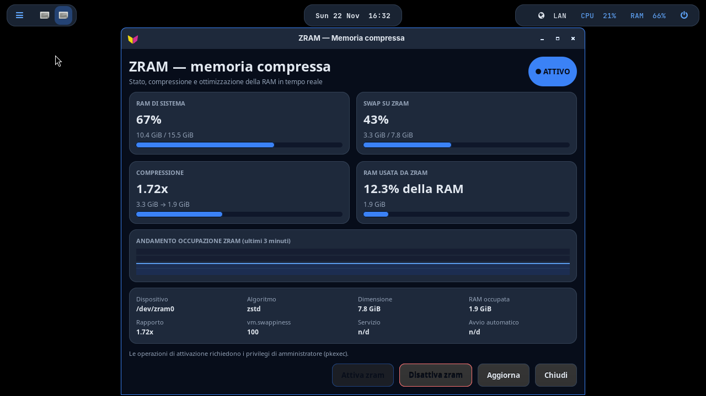

# labwc-q4os

**Desktop Wayland moderno, completo e veloce per Q4OS / Debian.**
Installazione automatizzata di **labwc + Waybar + Fuzzel**, tre temi coordinati
(blu, rosso tenue, verde salvia), sfondi originali generati in locale, menu
contestuale dinamico e ottimizzazione della memoria con zram.

> ### Lo scopo del progetto
>
> **labwc-q4os non sostituisce Q4OS: aggiunge una sessione Wayland moderna
> alla base Q4OS già collaudata.** L'obiettivo è unire la stabilità, la
> leggerezza e l'affidabilità di Q4OS con **labwc**, un compositor Wayland
> essenziale e reattivo, per ottenere **prestazioni più alte, avvio e
> interazione più veloci** e un desktop grafico curato, senza rinunciare alle
> sessioni Trinity/Plasma già installate. Le caratteristiche già collaudate e
> **performanti di Q4OS restano la fondazione**; labwc aggiunge il livello
> grafico moderno e selezionabile al login.

> **[Scarica Q4OS 6](https://www.q4os.org/downloads1.html)**

[](https://q4os.org)
[](https://debian.org)
[](https://labwc.github.io)
[](LICENSE)

> **reverseloop-dev** · https://github.com/reverseloop-dev/labwc-q4os · **v1.0.0**

---

## Perche' labwc-q4os

Q4OS e' stabile e leggero, ma la sua sessione principale non e' Wayland.
Questo progetto aggiunge una sessione **labwc** selezionabile dal display
manager, senza toccare Trinity, Plasma o le configurazioni esistenti.

- Compositor **labwc** con decorazioni arrotondate, ombre e snap alle metà
  dello schermo.
- **Waybar** moderna: taskbar, orologio/calendario, tray, audio,
  rete, batteria, CPU, RAM e menu sessione.
- **Fuzzel** come launcher: icone, ricerca fuzzy, bordi arrotondati e colori
  sincronizzati al tema.
- **Mako** per notifiche discrete, **swaybg** per lo sfondo, **swaylock**
  per bloccare lo schermo e **labwc-power-menu** per la sessione.
- Tre temi completi e intercambiabili a caldo.
- Tre sfondi 2560×1440 generati con Pillow, senza download esterni.
- Menu del tasto destro con **App preferite** gestibili dall'utente.
- **App nel menu Labwc**: gestore grafico con tasto destro per aggiungere ai
  preferiti, spostare in una categoria (es. Multimedia) o rimuovere.
- **Menu sessione affidabile** da Waybar: blocca, esci, sospendi, riavvia e
  spegni senza dipendere da wlogout.
- **Doppio clic sinistro sul desktop**: guida, scorciatoie, versioni delle app,
  versione script, data di aggiornamento e link al repository.
- Guida integrata in italiano con tasti rapidi e istruzioni di modifica file.
- **ZRAM — memoria compressa**: pannello grafico per attivare/disattivare zram
  con indicatori live di RAM, swap, compressione e cronologia.
- **Labwc Doctor**: controlli automatici e riparazione di configurazione,
  Waybar, menu, sessione, XWayland, portali, zram e log.
- zram e swappiness configurabili durante l'installazione.

---

## Anteprime

| Nordic Cobalt (blu) | Muted Crimson (rosso tenue) | Sage Emerald (verde salvia) |
|---|---|---|
|  |  |  |

Ogni sfondo riporta la firma discreta `reverseloop-dev` in basso a destra.

---

## Correzioni recenti

- Pulsante sessione di Waybar: ora apre `labwc-power-menu` e le azioni
  riavvio/spegnimento/sospensione/blocco funzionano davvero.
- Editor menu: aggiunta/rimozione più robuste, supporto `remove-id`,
  rimozione diretta dalla sezione **★ App preferite** e protezione dai loop
  su selezioni non valide.
- Nuovo **App nel menu Labwc** con menu contestuale tasto destro per
  preferiti e categorie.
- Doppio clic sinistro sul desktop: guida + informazioni di sistema.
- Pannello ZRAM: corrette unità RAM, label di stato e grafico storico, aggiunta
  dipendenza Cairo.
- Tema labwc: usato `themerc-override` (la vecchia posizione non veniva letta).
- Waybar: rimossi moduli workspace non disponibili nel pacchetto Debian;
  corretti colori `rgba` non validi.
- Aggiunto SDDM opzionale per TDM, con ritorno a TDM documentato.

---

## Requisiti

- **Q4OS 6.x** (base Debian 13) oppure **Debian 13 o successiva**.
  Q4OS 5.x / Debian 12 **non** includono labwc nei repository: in quel caso
  l'installer si ferma con un messaggio chiaro prima di modificare il sistema.
- GPU e driver in grado di eseguire una sessione Wayland (Intel, AMD, NVIDIA
  con driver proprietari aggiornati).
- Utente normale con privilegi `sudo`. **Non eseguire lo script come root.**
- Connessione internet per i pacchetti `apt` (circa 300–500 MB).
- `git` per l'installazione one-liner.

La sessione Q4OS preesistente resta intatta: labwc viene aggiunto come voce
in `/usr/share/wayland-sessions`. Se è attivo **TDM** — che non supporta
Wayland — l'installer propone di installare e attivare **SDDM** (default sì),
mantenendo Trinity/Plasma selezionabili al login. Con `--keep-tdm` il display
manager non viene toccato; in tal caso si può avviare Labwc da TTY con
`dbus-run-session labwc`.

---

## Installazione

### One-liner

```bash
curl -fsSL https://raw.githubusercontent.com/reverseloop-dev/labwc-q4os/main/bootstrap.sh | bash
```

Con opzioni:

```bash
curl -fsSL https://raw.githubusercontent.com/reverseloop-dev/labwc-q4os/main/bootstrap.sh \
  | bash -s -- --theme blue --yes
```

### Manuale

```bash
git clone https://github.com/reverseloop-dev/labwc-q4os.git
cd labwc-q4os
./install.sh
```

### Opzioni

| Opzione | Effetto |
|---|---|
| `--theme blue\|red\|green` | Tema iniziale: `nordic-cobalt`, `muted-crimson`, `sage-emerald` |
| `--theme nordic-cobalt` | Nome completo del tema |
| `--yes` | Nessuna domanda: zram e swappiness attivi, tema corrente o blu |
| `--zram` / `--no-zram` | Attiva/disattiva zram senza prompt |
| `--swappiness N` | Imposta `vm.swappiness` a `N` (0–200) |
| `--no-swappiness` | Non modificare `vm.swappiness` |
| `--sddm` | Installa e attiva SDDM se TDM non supporta Wayland |
| `--keep-tdm` | Non toccare il display manager |
| `--skip-apt` | Salta l'installazione pacchetti (solo configurazione) |
| `--force-os` | Procede anche su distribuzioni non Debian |
| `--help` | Aiuto |

Durante l'esecuzione lo script chiede:

1. **zram** — RAM compressa con `zstd`, 50% della RAM. Migliora la reattività
   su macchine con 4–8 GB.
2. **swappiness** — parametri `vm.swappiness` e `vm.vfs_cache_pressure`
   persistenti in `/etc/sysctl.d/99-labwc-performance.conf`.
3. **display manager** — solo se è attivo TDM: propone SDDM per rendere
   Labwc selezionabile al login (TDM resta installato).

Scelta tecnica trasparente: con zram lo swap avviene in RAM compressa, quindi
`vm.swappiness=100` è desiderabile e non consuma il disco. Senza zram il
valore scende a `10` per evitare swap su disco prematuri. In entrambi i casi
`vm.vfs_cache_pressure=50` mantiene in cache inode e dentry, riducendo il
lavoro del disco. Con zram viene anche impostato `vm.page-cluster=0`, ottimale
per la compressione in RAM.

zram viene configurato anche se scegli di non attivarlo: potrai accenderlo e
spegnerlo in qualsiasi momento dal pannello grafico **ZRAM — memoria
compressa** nel menu del tasto destro, con indicatori di uso, compressione,
swap e RAM in tempo reale.

Al termine, se SDDM è stato attivato riavvia il sistema e scegli **Labwc**
dal login. Con TDM: **Menu → Session Type → Labwc** (se disponibile).

I comandi `labwc-*` sono installati in `~/.local/bin`, che Debian/Q4OS
aggiunge al `PATH` al login. Se il tuo profilo non lo fa:

```bash
export PATH="$HOME/.local/bin:$PATH"
```

---

## Dopo l'installazione

Al primo login partono automaticamente:

- lo sfondo del tema attivo (`swaybg`);
- Waybar con la configurazione e il tema correnti;
- Mako per le notifiche;
- `nm-applet` e `lxpolkit`;
- la cronologia appunti con `cliphist` (se installato).

### Tasti rapidi

`Super` è il tasto Windows/Logo.

| Combinazione | Azione |
|---|---|
| `Super + Invio` | Terminale Foot |
| `Super + D` / `Super + Spazio` / `Alt + F2` | Launcher Fuzzel |
| `Super + E` | File manager (pcmanfm) |
| `Super + Q` / `Alt + F4` | Chiudi finestra |
| `Super + A` | Massimizza / ripristina |
| `Super + F` | Schermo intero |
| `Super + Frecce` | Snap a sinistra/destra/alto/basso |
| `Super + Tab` / `Alt + Tab` | Finestra successiva |
| `Super + 1…4` | Vai al desktop |
| `Super + Shift + 1…4` | Sposta finestra sul desktop |
| `Super + Shift + R` | Ricarica menu, tema e Waybar |
| `Super + Shift + T` | Cambia tema |
| `Super + Shift + M` | Editor app del menu |
| `Super + Shift + H` | Guida completa |
| `Stampa` / `Super + Shift + S` | Screenshot area (grim + slurp) |
| `Super + Stampa` | Screenshot schermo intero |
| `Super + L` | Blocca schermo |
| `Super + Ctrl + L` | Menu sessione |
| Tasti volume/luminosità | Audio e brightnessctl |

Tasto destro sul desktop: menu completo. **Doppio clic sinistro sul desktop:**
guida, scorciatoie e informazioni di sistema (versioni, tema, repo, ultimo
aggiornamento). Tasto destro sul titolo: menu della finestra. Rotellina sul
desktop: cambia desktop.

---

## Temi

| Tema | Palette | Carattere |
|---|---|---|
| **Nordic Cobalt** | `#1e293b` · `#3b82f6` | Blu profondo, riposante, tech |
| **Muted Crimson** | `#261c1e` · `#c0565b` | Rosso spento, caldo, sofisticato |
| **Sage Emerald** | `#1b2624` · `#4d9375` | Verde salvia, equilibrato, naturale |

Il cambio tema aggiorna in tempo reale:

- `themerc-override` di labwc (bordi, titoli, menu, OSD, snap overlay);
- `~/.config/waybar/style.css`;
- `~/.config/fuzzel/fuzzel.ini`;
- `~/.config/mako/config`;
- `~/.config/wlogout/style.css`;
- lo sfondo del desktop.

Comandi:

```bash
labwc-theme-switcher                 # selettore Fuzzel/Zenity
labwc-theme-switcher nordic-cobalt   # cambio diretto
labwc-theme-switcher muted-crimson
labwc-theme-switcher sage-emerald
```

Gli sfondi sono generati localmente da `scripts/generate-wallpapers.py` con
Pillow: gradienti mesh, geometrie sottili, grana e vignettatura. Nessun link
esterno, nessuna licenza di terzi.

Rigenerazione:

```bash
labwc-generate-wallpapers
```

Le immagini finiscono in `~/.local/share/labwc-q4os/wallpapers/`.

---

## Menu del tasto destro

Il menu e' generato dinamicamente da `scripts/render-menu.py` leggendo i file
`.desktop` installati:

1. **★ App preferite** — scelte dall'utente, in cima al menu.
2. **Categorie** — Internet, Multimedia, Grafica, Ufficio, Sviluppo, Giochi,
   Istruzione, Scienza, Sistema, Impostazioni, Accessori, Altre applicazioni.
3. **Labwc & Desktop** — gestione app/preferite, cambio tema, editor rapido
   Fuzzel, ricarica, aiuto, screenshot, pannello zram, diagnostica, blocco
   schermo e menu sessione.

### App nel menu, preferite e categorie

Fuzzel **non supporta menu contestuali per singola voce**: il tasto destro su
un'app dentro Fuzzel non può essere intercettato. Per ottenere la stessa
funzione c'è **App nel menu Labwc** (`labwc-app-manager`), apribile da:

- tasto destro sull'icona launcher di Waybar;
- menu desktop → **Labwc & Desktop → Gestisci app e preferite**;
- ricerca Fuzzel: “App nel menu Labwc”.

Qui il **tasto destro su una riga** permette di:

- **Aprire** l'app;
- **Aggiungere ai preferiti**;
- **Spostare in categoria** (Multimedia, Internet, Grafica, Ufficio, ...);
- **Rimuovere dai preferiti**;
- **Ripristinare la categoria automatica**.

Nella sezione **★ App preferite** del menu desktop è presente anche
**“Rimuovi dai preferiti...”**, per eliminare una voce senza aprire l'editor.


### Aggiungere o rimuovere app

Tasto destro → **Labwc & Desktop** → **Gestisci app e preferite**
(oppure `Super + Shift + M` per l'editor rapido Fuzzel).

L'editor usa Fuzzel (`--dmenu`) su Wayland, con fallback a Zenity e Whiptail.
Legge:

- `/usr/share/applications`
- `/usr/local/share/applications`
- `~/.local/share/applications`
- esportazioni Flatpak
- Snap desktop entries

Ad ogni modifica:

1. `~/.config/labwc/favorites.tsv` viene aggiornato;
2. `menu.xml` viene rigenerato;
3. `labwc --reconfigure` applica il menu immediatamente.

`favorites.tsv` sopravvive agli aggiornamenti e alle reinstallazioni.
Il menu e' già aggiornato: non serve riavviare la sessione.

### Ricarica manuale

Voce **Ricarica menu e desktop** oppure `Super + Shift + R`:

- `labwc --reconfigure`;
- riavvio di Waybar;
- `makoctl reload`.

---

## Aiuto integrato

`Super + Shift + H`, doppio clic sinistro sul desktop, oppure tasto destro →
**Aiuto, scorciatoie e sistema**, apre una guida italiana con:

- tutti i tasti rapidi;
- uso di Fuzzel e modalità `--dmenu`;
- percorso e scopo di ogni file di configurazione;
- esempi per modificare `rc.xml`, `style.css`, `fuzzel.ini`, `mako/config`,
  `autostart` e `environment`;
- comandi di ricarica e troubleshooting;
- gestione screenshot e cronologia appunti;
- versione script, data di installazione, versioni delle app, tema, sessione
  e link al repository.

Il file sorgente è `~/.config/labwc/help.txt`.

---

## ZRAM — memoria compressa

Pannello grafico: tasto destro → **Labwc & Desktop** → **ZRAM — memoria
compressa**, oppure `labwc-zram`.

Mostra in tempo reale:

- stato **attivo / non attivo** e avvio automatico del servizio `zramswap`;
- barra della RAM di sistema e barra dello swap su zram;
- rapporto di compressione e RAM realmente occupata da zram;
- grafico dell'occupazione degli ultimi 3 minuti;
- dispositivo, algoritmo (`zstd`), dimensione, `vm.swappiness`.

Pulsanti **Attiva zram** e **Disattiva zram**: eseguono `systemctl
enable/disable --now zramswap` tramite `pkexec` e l'agente polkit della
sessione. L'attivazione abilita anche zram all'avvio.

Da terminale:

```bash
labwc-zram --status
labwc-zram --enable
labwc-zram --disable
```

Configurazione: `/etc/default/zramswap` (`ALGO=zstd`, `PERCENT=50`,
`PRIORITY=100`). L'installer scrive sempre questa configurazione, anche se
scegli di non attivare subito zram.



> Nota: il pannello è stato verificato in ambiente Debian 13 con Python
> PyGObject/GTK3. Se GTK non è disponibile, `labwc-zram --status` resta
> utilizzabile e l'installer segnala la dipendenza mancante.

---

## Labwc Doctor

Controlli automatici e riparazione:

```bash
labwc-doctor
labwc-doctor --fix
labwc-doctor --fix-system
```

Verifica:

- labwc e versione minima;
- comandi essenziali e opzionali;
- `/dev/dri`, sessione Wayland e processi Waybar/Mako/swaybg;
- `XDG_RUNTIME_DIR` e permessi;
- XML di `rc.xml` e `menu.xml`, JSON di Waybar, token CSS non risolti;
- tema, sfondo, menu, preferite, Waybar, Fuzzel, Mako, wlogout;
- sessione `/usr/share/wayland-sessions/labwc.desktop`;
- display manager e supporto Wayland;
- XWayland e portali;
- zram, `vm.swappiness`, `vm.vfs_cache_pressure`;
- errori recenti in `~/.local/state/labwc-q4os/session.log`.

`--fix` ripristina i file utente mancanti dai template, rigenera tema e menu,
ricrea lo sfondo e ricarica il desktop. `--fix-system` ripristina anche la
sessione Wayland con `sudo`. Dal menu: **Labwc & Desktop → Diagnostica e
ripara desktop**.

---

## Waybar

Moduli attivi:

| Modulo | Interazione |
|---|---|
| Launcher icona menu | Click: Fuzzel · tasto destro: App nel menu Labwc |
| Taskbar | Click: attiva · centrale: chiude · destro: fullscreen |
| Orologio | Click: calendario · tooltip: mese |
| Tray | Applicazioni di sistema |
| Audio | Click: `pavucontrol` |
| Rete | Click: `nm-connection-editor` |
| Batteria | Dettagli con `upower` (se presente) |
| CPU / RAM | Utilizzo in tempo reale |
| icona sessione | Click: menu sessione · destro: swaylock |

Il modulo workspace sperimentale (`wlr/workspaces`) non è incluso nel pacchetto
Waybar di Debian. La barra usa quindi la **taskbar** con le finestre aperte; per
cambiare desktop usa `Super + 1…4` (o la rotellina sul desktop).

File:

```text
~/.config/waybar/config.jsonc
~/.config/waybar/style.css
```

Dopo una modifica: `Super + Shift + R`.

---

## Fuzzel

File: `~/.config/fuzzel/fuzzel.ini`.

- icone abilitate;
- font Inter con fallback;
- bordo arrotondato, overlay centrato;
- colori del tema attivo.

Uso da terminale:

```bash
fuzzel
printf 'Voce 1\nVoce 2\n' | fuzzel --dmenu
scelta="$(printf 'Si\nNo\n' | fuzzel --dmenu --prompt='Confermi? ')"
```

---

## Struttura del repository

```text
labwc-q4os/
├── install.sh                     # entry point
├── bootstrap.sh                   # one-liner: clone + install
├── VERSION                        # versione script
├── configs/
│   ├── labwc/rc.xml               # keybind, mouse, desktop
│   ├── labwc/autostart            # avvio sessione
│   ├── labwc/environment          # variabili Wayland
│   ├── waybar/config.jsonc
│   ├── waybar/style.css.in        # template colorato
│   ├── fuzzel/fuzzel.ini.in
│   ├── mako/config.in
│   ├── wlogout/{layout,style.css.in}
│   ├── gtk/settings.ini
│   └── themes/<tema>/{theme.conf,themerc}
├── scripts/
│   ├── generate-wallpapers.py     # sfondi con Pillow
│   ├── render-menu.py             # menu.xml dinamico
│   ├── labwc-theme-apply          # applica un tema
│   ├── labwc-theme-switcher       # selettore tema
│   ├── labwc-menu-editor          # aggiungi/rimuovi app
│   ├── labwc-reload               # reconfigure + Waybar
│   ├── labwc-screenshot           # grim + slurp
│   ├── labwc-zram                 # pannello GTK zram
│   ├── labwc-app-manager          # gestore app/preferite/categorie
│   ├── labwc-power-menu           # menu sessione Fuzzel/Zenity
│   ├── labwc-sysinfo              # versioni e informazioni sistema
│   ├── labwc-doctor               # diagnostica e riparazione
│   ├── labwc-session-start        # autostart sessione
│   ├── labwc-help                 # visualizzatore guida
│   ├── labwc-generate-wallpapers
│   ├── help.txt                   # guida italiana
│   └── validate.sh                # controlli statici e smoke test
├── preview/                       # anteprime sfondi e ZRAM
├── LICENSE
└── README.md
```

---

## File installati

Configurazione utente:

```text
~/.config/labwc/rc.xml
~/.config/labwc/menu.xml
~/.config/labwc/favorites.tsv
~/.config/labwc/placements.tsv
~/.config/labwc/themerc-override
~/.config/labwc/theme
~/.config/labwc/autostart
~/.config/labwc/environment
~/.config/labwc/help.txt
~/.config/waybar/config.jsonc
~/.config/waybar/style.css
~/.config/fuzzel/fuzzel.ini
~/.config/mako/config
~/.config/wlogout/layout
~/.config/wlogout/style.css
~/.config/gtk-3.0/settings.ini
~/.config/gtk-4.0/settings.ini
~/.config/applications/labwc-theme-switcher.desktop
~/.config/applications/labwc-menu-editor.desktop
~/.config/applications/labwc-help.desktop
~/.config/applications/labwc-zram.desktop
~/.config/applications/labwc-doctor.desktop
~/.config/applications/labwc-app-manager.desktop
~/.config/applications/labwc-sysinfo.desktop
```

Dati e strumenti:

```text
~/.local/share/labwc-q4os/{themes,templates,wallpapers,scripts}
~/.local/bin/labwc-*
~/.local/state/labwc-q4os/session.log
~/.local/share/labwc-q4os/backups/<data>/
```

Sistema (con `sudo`):

```text
/usr/share/wayland-sessions/labwc.desktop
/etc/default/zramswap                         # sempre, zram attivabile dal menu
/etc/sysctl.d/99-labwc-performance.conf       # solo se swappiness attivo
```

---

## Verifica e sviluppo

Controlli statici e smoke test in una HOME temporanea (non toccano la tua
configurazione):

```bash
./scripts/validate.sh
```

Lo script verifica:

- `bash -n` su tutti gli script;
- compilazione Python (incluso `labwc-zram --status`);
- JSON di Waybar e wlogout;
- XML di labwc;
- permessi `+x`;
- rendering dei tre temi senza token `@@...@@` residui;
- generazione e validazione di `menu.xml`;
- `shellcheck` se installato.

---

## Troubleshooting

**Prima di tutto: esegui la diagnostica**

```bash
labwc-doctor
labwc-doctor --fix
labwc-doctor --fix-system
```

Il doctor controlla configurazioni, permessi, sessione, barra, tema, menu,
zram, portali, XWayland e log, e ripara i file utente mancanti. Dal menu:
**Labwc & Desktop → Diagnostica e ripara desktop**.

**Il pulsante sessione di Waybar non faceva nulla**
Corretto: ora apre `labwc-power-menu` (Fuzzel/Zenity) con blocco, uscita,
sospensione, riavvio e spegnimento. Se un'azione di sistema viene negata,
controlla che `lxpolkit` sia attivo e che il servizio `polkit` sia in esecuzione.

**Non riesco ad aggiungere/rimuovere un'app dal menu**
Usa **App nel menu Labwc** col tasto destro sulla riga, oppure
**Labwc & Desktop → Gestisci app e preferite**. Fuzzel non ha un menu
contestuale per voce. Le preferite si rimuovono anche da **★ App preferite →
Rimuovi dai preferiti...**.

**La sessione Labwc non compare nel display manager**
Verifica che esista `/usr/share/wayland-sessions/labwc.desktop`. Il display
manager deve supportare Wayland: su alcune installazioni Q4OS con **TDM**
le sessioni Wayland non vengono elencate. In quel caso si può avviare da TTY:

```bash
dbus-run-session labwc
```

oppure usare SDDM come display manager. Lo script non cambia il display
manager per non alterare la configurazione Q4OS esistente.

**Waybar non parte**
```bash
cat ~/.local/state/labwc-q4os/session.log
waybar -c ~/.config/waybar/config.jsonc -s ~/.config/waybar/style.css
jq . ~/.config/waybar/config.jsonc
```

**Il menu non si aggiorna**
```bash
labwc --reconfigure
# oppure
labwc-reload
```

**Un'app non compare nel menu**
Controlla che il file `.desktop` abbia un `Exec` valido e che il programma sia
installato:

```bash
grep -E '^(Name|Exec|NoDisplay|Hidden)=' /usr/share/applications/nome.desktop
```

**Il tema non cambia dopo il login**
`~/.config/labwc/theme` deve contenere esattamente uno tra:
`nordic-cobalt`, `muted-crimson`, `sage-emerald`.

**Tornare a TDM dopo aver installato SDDM**
```bash
sudo systemctl disable sddm.service
sudo systemctl enable tdm.service
sudo ln -sf /usr/lib/systemd/system/tdm.service /etc/systemd/system/display-manager.service
printf '/usr/sbin/tdm\n' | sudo tee /etc/X11/default-display-manager
```
Il percorso di TDM può essere `/usr/sbin/tdm` o `/opt/trinity/bin/tdm`; verifica
con `command -v tdm` prima di sovrascrivere il file.

**Ripristinare le configurazioni precedenti**
I backup sono in:

```text
~/.local/share/labwc-q4os/backups/<data>/
```

Copiali indietro nelle rispettive directory `~/.config/`.

**Disinstallare la sessione**
```bash
rm -rf ~/.config/labwc ~/.config/waybar ~/.config/fuzzel ~/.config/mako ~/.config/wlogout
rm -f ~/.local/bin/labwc-theme-apply ~/.local/bin/labwc-theme-switcher \
      ~/.local/bin/labwc-menu-editor ~/.local/bin/labwc-reload \
      ~/.local/bin/labwc-generate-wallpapers ~/.local/bin/labwc-help \
      ~/.local/bin/labwc-screenshot ~/.local/bin/labwc-zram \
      ~/.local/bin/labwc-doctor ~/.local/bin/labwc-session-start
rm -f ~/.config/applications/labwc-theme-switcher.desktop \
      ~/.config/applications/labwc-menu-editor.desktop \
      ~/.config/applications/labwc-help.desktop \
      ~/.config/applications/labwc-zram.desktop \
      ~/.config/applications/labwc-doctor.desktop
rm -rf ~/.local/share/labwc-q4os ~/.local/state/labwc-q4os
sudo rm -f /usr/share/wayland-sessions/labwc.desktop
```
Rimuovi zram/sysctl solo se non ti servono:
```bash
sudo rm -f /etc/sysctl.d/99-labwc-performance.conf
sudo systemctl disable --now zramswap.service
```

---

## Sicurezza e comportamento

- Lo script **non** viene eseguito come root; usa `sudo` solo per `apt`,
  `/usr/share/wayland-sessions` e i file in `/etc`.
- Non modifica il display manager, la sessione predefinita, GRUB o i driver.
- Le configurazioni esistenti vengono salvate prima di essere sostituite.
- `apt-get` usa `--no-install-recommends` e opzioni non interattive.
- Nessun dato viene inviato all'esterno: sfondi e menu sono generati in locale.
- Le app nel menu vengono filtrate in base a `NoDisplay`, `Hidden`, `TryExec`
  ed esistenza dell'eseguibile.

---

## Licenza

MIT — vedi [LICENSE](LICENSE).

Progetto e design: **reverseloop-dev**.
Segnalazioni e pull request: https://github.com/reverseloop-dev/labwc-q4os
