# labwc-q4os  

**Una seconda vita per i PC che il mercato considera vecchi.**

**labwc-q4os è lo script “resuscita morti”:** riporta a un sistema Debian
completo, veloce e amministrabile macchine che altrimenti sarebbero state
sostituite, senza cambiare hardware.

Ogni anno milioni di computer ancora perfettamente funzionanti vengono
dismessi solo perché il software di serie è diventato lento, pesante o non più
aggiornato. **labwc-q4os** li trasforma in postazioni veloci, moderne e sicure,
senza cambiare hardware.

L'idea è il **riuso consapevole**. Non serve una macchina nuova per navigare,
scrivere, lavorare o studiare: serve un sistema costruito bene. Per questo il
progetto parte dalla solidità di **Debian**, aggiunge la configurazione pronta
e collaudata di **Q4OS** e usa **labwc su Wayland** come desktop: un compositor
(il programma che disegna le finestre) essenziale che consuma poche risorse,
riduce il carico di CPU e RAM e rende l'interazione più immediata, anche con
pochi gigabyte di memoria.

Il risultato è un desktop curato e completo, con tre temi coordinati, un login
moderno e tutti gli strumenti di uso quotidiano già configurati. Le sessioni
Trinity e Plasma restano disponibili: labwc-q4os **aggiunge** una sessione,
non impone una sostituzione.

**Non è l'ennesima “distro veloce”.** È un intervento mirato: installato sopra
una base già solida, restituisce un sistema completo senza toccare l'hardware.
L'installazione è pensata per **Q4OS 6** (la configurazione collaudata oggi) e
per una **Debian pura** (supporto in fase di test): in entrambi i casi aggiunge
il desktop leggero, gli strumenti di amministrazione e tutto ciò che serve per
lavorare ogni giorno.

**Scegli la tua base, aggiungi il desktop leggero.** Q4OS, Debian o la
distribuzione Debian-derivata che preferisci: lo script si occupa di labwc,
barra, launcher, temi, login, aggiornamenti e diagnostica. L'obiettivo è un
sistema **Debian perfettamente funzionante, veloce, intuitivo e facile da
amministrare**, reattivo anche su macchine con **1 GB di RAM**, senza perdere
grafica, sessioni esistenti o possibilità di scelta.

 **RAM consigliata:** scegli **Waybar + Fuzzel** se la VM ha **1–2 GB**;
 **Noctalia** solo se vuoi testarla con più RAM.

> ### Riuso, stabilità, prestazioni
>
> Meno rifiuti elettronici, più computer utili. labwc-q4os non richiede hardware recente né sistemi sperimentali: unisce la solidità di Debian e le ottimizzazioni di Q4OS alla leggerezza di labwc, offrendo un desktop  >
> Wayland moderno, rapido e dai consumi ridotti.
>
> In più, per massimizzare batteria, RAM e CPU, integra la modalità cage (kiosk): l'avvio diretto da shell di una singola applicazione predefinita, eliminando ogni elemento grafico superfluo. Il PC che hai già può tornare a essere veloce.
>
> **[Scarica Q4OS 6](https://www.q4os.org/downloads1.html)**

[](https://q4os.org)
[](https://debian.org)
[](https://labwc.github.io)
[](LICENSE)

> **reverseloop-dev** · https://github.com/reverseloop-dev/labwc-q4os · **v1.27.3**

---

<table>
<tr>
<td width="50%">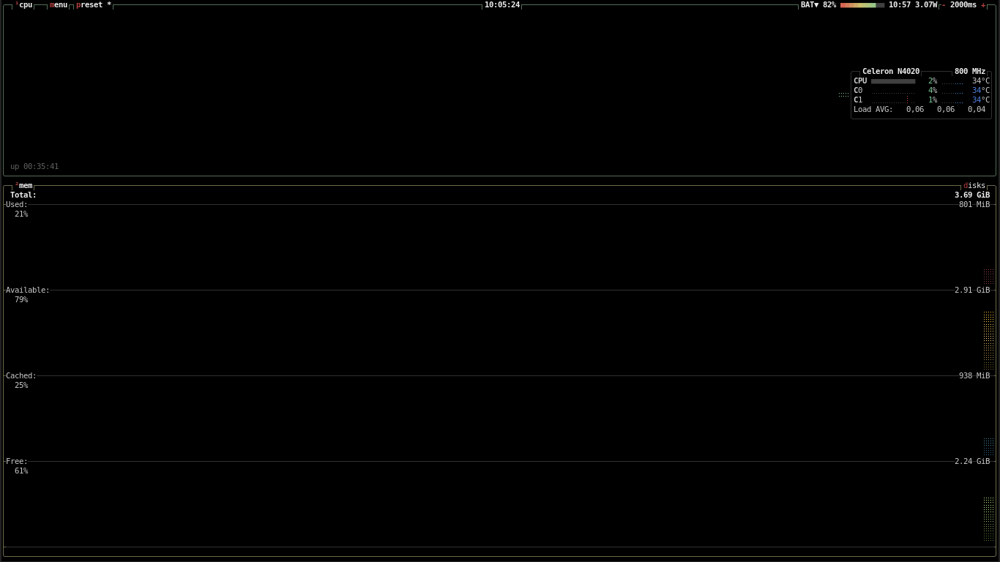<br><em><b>btop++</b> a tutto schermo in <b>labwc</b> con <b>Noctalia</b>, solo CPU e memoria: <b>≈801 MiB</b> usati, CPU 2%. La shell consuma più di Waybar.</em></td>
<td width="50%">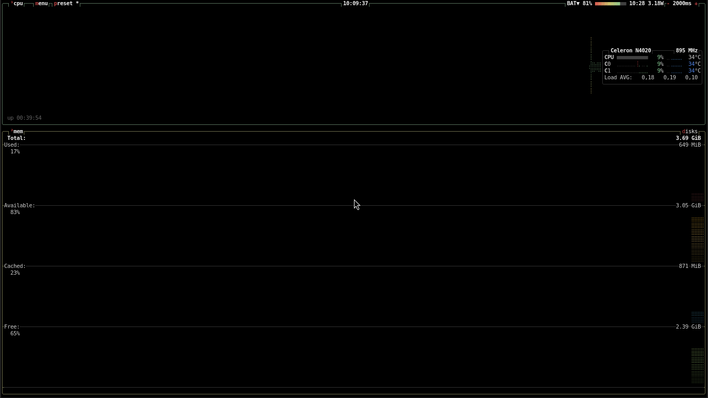<br><em><b>btop++</b> a tutto schermo in <b>cage-kiosk</b>, solo CPU e memoria: <b>≈649 MiB</b> usati, CPU 0%. Nessuna shell né barra.</em></td>
</tr>
<tr>
<td width="50%">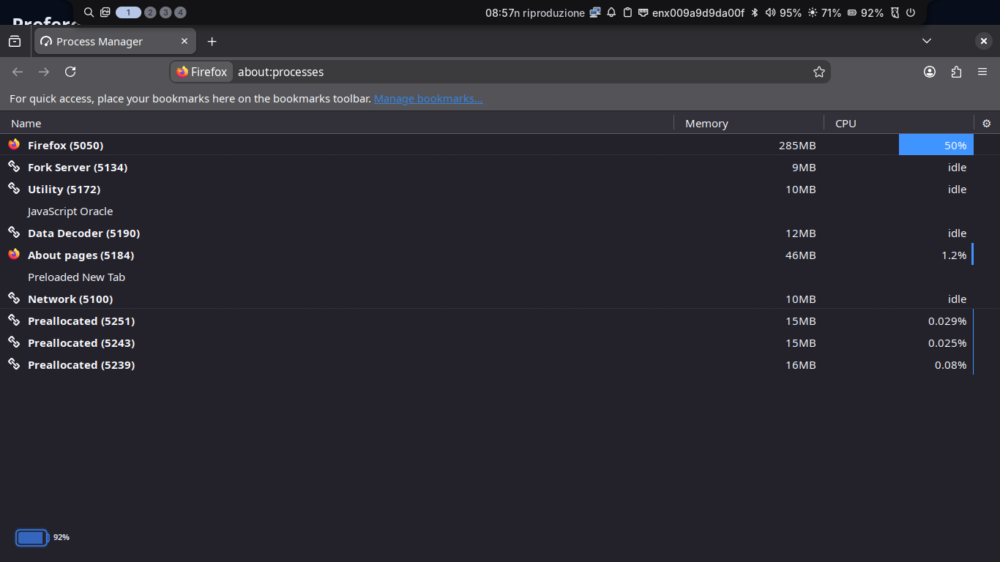<br><em><b>Firefox</b> in <b>labwc + Noctalia</b>: i consumi letti da <code>about:processes</code>.</em></td>
<td width="50%">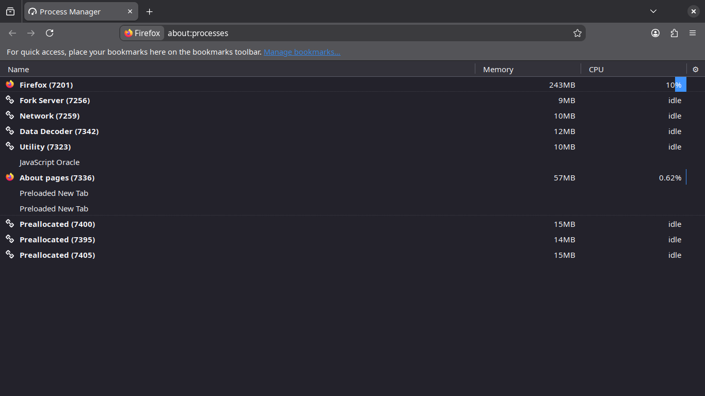<br><em><b>Firefox</b> in <b>cage-kiosk</b>: gli stessi consumi da <code>about:processes</code>.</em></td>
</tr>
</table>
<p><em>Per tenere sott'occhio la carica anche quando la barra non si guarda, il progetto include una piccola app <b>indicatore batteria</b> sempre in basso: contorno neon, riempimento e percentuale. Segue la colorazione del tema; la posizione è selezionabile tra <b>sinistra, centro e destra</b>.</em></p>


<table>
<tr>
<td align="center">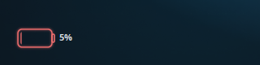<br><em>Rosso, sinistra</em></td>
<td align="center">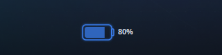<br><em>Blu, centro</em></td>
<td align="center">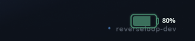<br><em>Verde, destra</em></td>
</tr>
</table>

## Trinity o Labwc: scegli tu

**Q4OS resta il sistema di base.** labwc-q4os non sostituisce Trinity o
Plasma: aggiunge una sessione **labwc** selezionabile al login. Puoi tenere
tutto e scegliere ogni volta l'ambiente che preferisci.

- **Trinity** è la sessione classica di Q4OS: barra, menu Start e disposizione
  simile a Windows. È la scelta giusta se arrivi da Windows, se ti trovi meglio
  con un'interfaccia tradizionale o se vuoi restare fedele al desktop Q4OS.
  L'installer può aggiungere **LookSwitcher** (solo per Trinity) per cambiarne
  i temi in un clic.
- **Labwc** è la sessione Wayland di questo progetto: compositor minimale,
  **massima reattività**, poche distrazioni e consumo ridotto di CPU, RAM e
  GPU. È pensata per chi vuole un desktop moderno ed essenziale, soprattutto su
  PC vecchi o poco potenti.
- **Plasma** resta disponibile per chi preferisce l'ambiente KDE completo.
  Richiede però molta più RAM e spazio su disco: è **sconsigliato** su PC
  datati o con poca memoria (RAM) o poco spazio di archiviazione.

In breve: **Trinity per la familiarità di Windows, Labwc per la reattività e
un ambiente sobrio.**

## Cosa aggiunge labwc-q4os

- Compositor **labwc** con decorazioni arrotondate, ombre e snap; finestre con
  i tre pulsanti classici.
- **Waybar + Fuzzel** (default) oppure **Noctalia v5**: barra, launcher,
  notifiche, orologio, tray e menu sessione, con la leggerezza di componenti
  separati o l'integrazione di una shell unica.
- **Mako** per le notifiche, **swaybg** per lo sfondo, **swaylock** per il
  blocco e **labwc-power-menu** per la sessione.
- Tre temi completi e intercambiabili a caldo, con tre sfondi 2560×1440 e icone
  SVG originali coordinate alla palette.
- **Grafica coerente**: tutte le app del progetto (Preferenze, ZRAM, Login,
  Aggiornamenti, App in Fuzzel, App nel menu) seguono il tema attivo.
- **Tre schermate di login SDDM** con layout diversi (Aurora Card, Split
  Studio, Bottom Dock), tastiera IT e sessione Labwc preselezionata. Il login
  può seguire automaticamente i colori dello sfondo.
- **App nel menu Labwc** e **App in Fuzzel**: aggiungi, organizza o rimuovi le
  applicazioni con selezione icona; le voci di sistema restano protette.
- **Chromium** oppure **Firefox ESR**, con le tre estensioni
  (**uBlock**, **Privacy Badger**, **enhanced-h264ify**); **qpdfview** come
  lettore PDF leggero; **FreeTube** per YouTube con GUI; **btop** per
  monitorare il sistema.
- **Wizard di installazione** GTK: pagine colorate con il tema, angoli
  arrotondati, scelte sì/no e **Indietro/Avanti** fino alla prima pagina.
- **Preferito YouTube 360p** in Chromium e Firefox ESR; aggiornamenti delle app
  esterne (Firefox ESR, Noctalia) tramite i loro repository APT.
- **RIDOTTO AD ICONA** sotto **File manager**: menu dinamico (pipemenu) con
  le finestre ridotte a icona; un clic le ripristina, anche con Noctalia.
- **ZRAM**, **Labwc Doctor**, **Preferenze**, desktop 1–4 e guida integrata in
  italiano.
- **Indicatore batteria** in basso (sinistra, centro o destra) con percentuale
  esatta, riempimento proporzionale e contorno neon; posizione e percentuale si
  scelgono dalle **Preferenze**.
- **Menu corto**: Impostazioni e TOOL reverseloop raggruppati in sottomenu
  tematici, così le voci non vengono tagliate. Le app create dall'utente
  (file `.desktop` in `~/.local/share/applications`) finiscono tutte dentro
  **TOOL reverseloop**, nelle stesse categorie del menu principale, e le
  chiamate duplicate (stesso programma, preferite, voci fisse) vengono
  eliminate: ogni app compare una sola volta.
- **Bluetooth** spento di default; se lo accendi da *TOOL reverseloop >
  Sistema e diagnostica > Bluetooth* (o con `bluetoothctl`) resta acceso anche
  dopo il riavvio, e se lo spegni resta spento.
- **GRUB** (solo se rispondi sì alla domanda, default no): attesa del menu di
  avvio ridotta a **1 secondo**, con backup di `/etc/default/grub`.
- **Aggiornamenti interattivi**: controllo versione, popup di avviso con
  chiusura dopo 15 s e aggiornamento nel terminale che rifà le domande.
- zram e swappiness configurabili durante l'installazione.

**In sintesi:** prima scegli se modificare i parametri; poi una piccola GUI
con checkbox raccoglie le scelte di installazione (browser, shell, zram,
swappiness, touchscreen, LookSwitcher, qpdfview). La shell
completa con layout tastiera, display manager e tema. Poi parte
l'installazione. Ogni domanda ha un flag corrispondente (`--keyboard`,
`--zram`, `--touch`, `--lookswitcher`, `--shell`, `--sddm`, `--theme`,
`--browser`, `--qpdfview`, `--grub-1s`); `--quick` e `--configure` forzano
aggiornamento rapido o configurazione.

---

## Anteprime

| Nordic Cobalt (blu) | Muted Crimson (rosso tenue) | Sage Emerald (verde salvia) |
|---|---|---|
|  | 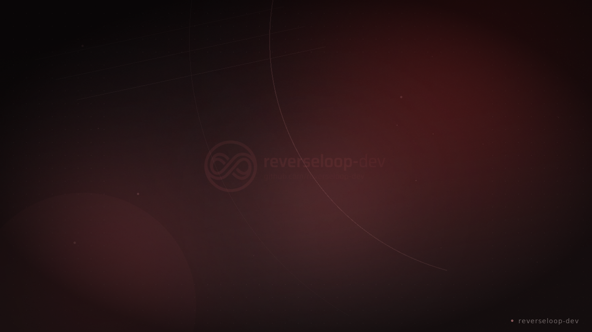 | 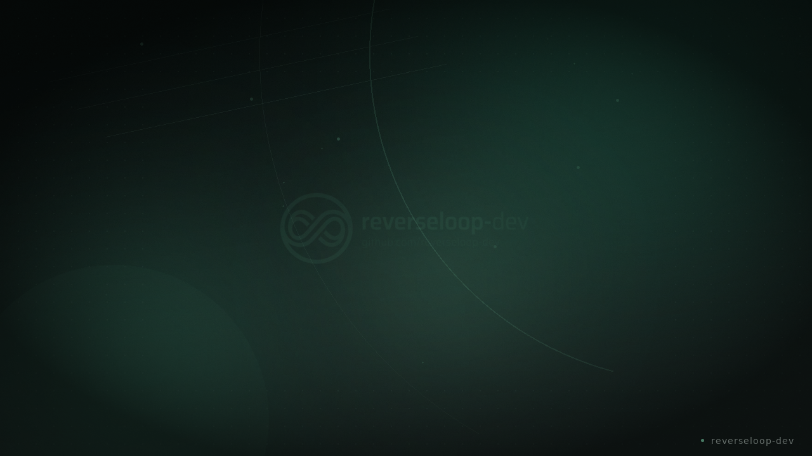 |

Ogni sfondo riporta la firma discreta `reverseloop-dev` in basso a destra.

### Le app del progetto

| Preferenze della scrivania | App nel menu Labwc |
|---|---|
| 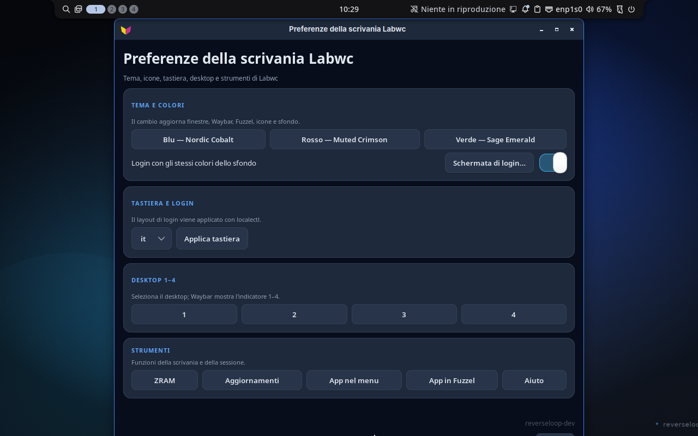 |  |

| Aggiornamenti e storico versioni | ZRAM — memoria compressa |
|---|---|
| 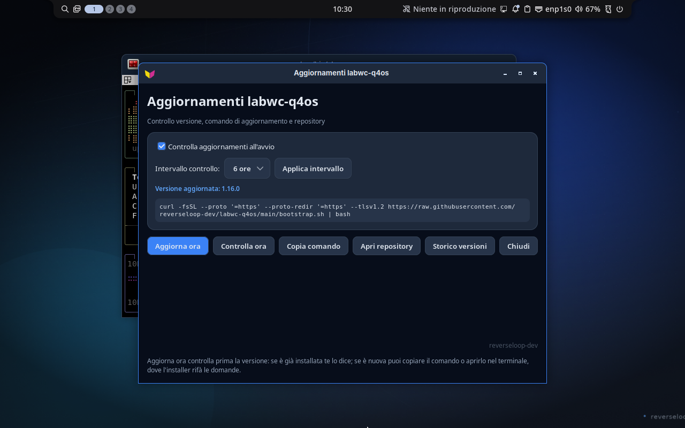 | 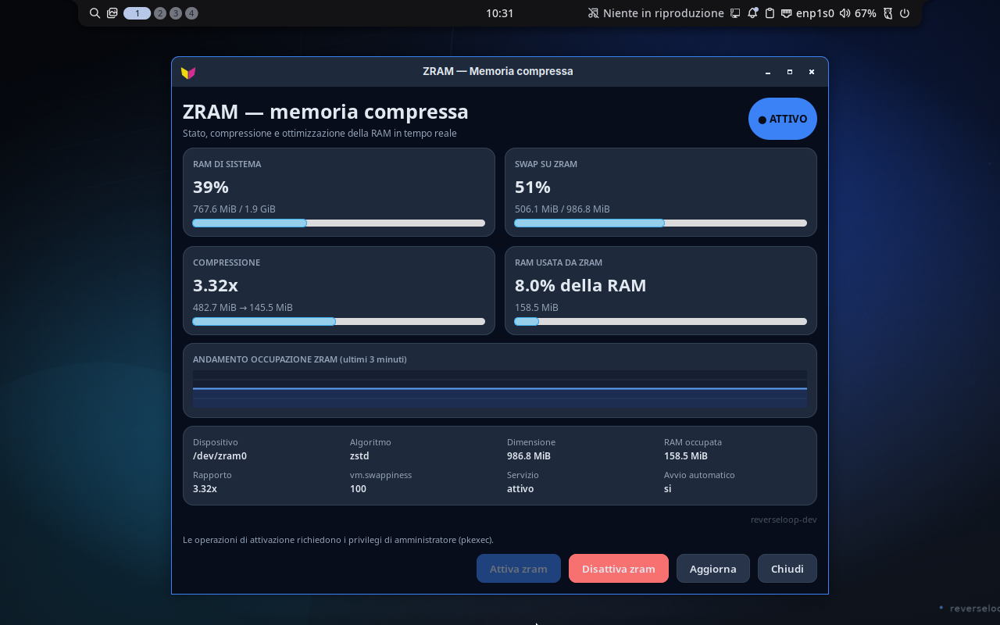 |

Tutte le finestre usano le decorazioni di labwc con i tre pulsanti
**riduci a icona, ingrandisci, chiudi** in alto a destra. Anche Chromium viene
avviato con le opzioni Wayland e le decorazioni richieste.

---

## Correzioni recenti

- **Scala dello schermo**: due slider identici, uno per le **finestre** e uno
  per il **menu**. Quello del menu ridimensiona anche i titoli delle finestre
  (font in `rc.xml` e padding in `themerc-override`); prima il menu restava
  grande. Voce in **TOOL reverseloop → Schermo e monitor**.
- **Posizione della barra**: nelle Preferenze si sceglie **Alto** o **Basso**
  per Waybar e Noctalia; la scelta è immediata e resta dopo login e
  aggiornamenti (`~/.config/labwc/bar-position`).
- **Sfondi**: logo **reverseloop-dev** al centro, semitrasparente e tono su
  tono, integrato nel generatore e nei tre sfondi definitivi.
- **Aggiornamenti**: la versione online è letta dall'API GitHub, non dal file
  raw della branch che resta in cache CDN; le nuove release si vedono subito.
- **Indicatore batteria**: switch **Icona** accanto a **Percentuale** per
  mostrare o nascondere l'indicatore completo.
- **Scroll verticale** in tutte le app reverseloop quando la finestra non
  entra nello schermo.
- **README**: screenshot di **btop++** (solo CPU e memoria) e **Firefox** in
  labwc con Noctalia e in cage-kiosk, con didascalia.

Tutte le modifiche, release per release: **[CHANGELOG.md](CHANGELOG.md)**.

---

## Login moderno SDDM

Se il sistema usa **TDM**, l'installer propone di passare a **SDDM** (default
sì; `--keep-tdm` per restare su TDM). Con SDDM vengono installate **tre
schermate di login complete**, ognuna con layout e stile diversi:

| Tema | Colore | Layout |
|---|---|---|
| **Aurora Card** | blu | card di vetro centrale, aurora animata, griglia di punti |
| **Split Studio** | rosso tenue | pannello laterale con orologio grande, form a destra, spigoli netti |
| **Bottom Dock** | verde salvia | barra orizzontale in basso, alone radiale, form compatto |

Tutte hanno selettore **utente** e **sessione** (Trinity/TDE e Labwc), campo
password, orologio e data in italiano, pulsanti Spegni/Riavvia/Sospendi e
l'indicazione **Tastiera: IT**. La sessione **Labwc è preselezionata**.

| Aurora Card (blu) | Split Studio (rosso) | Bottom Dock (verde) |
|---|---|---|
| 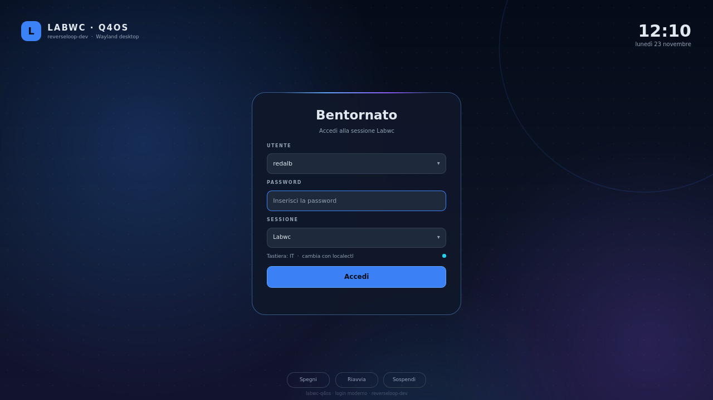 |  | 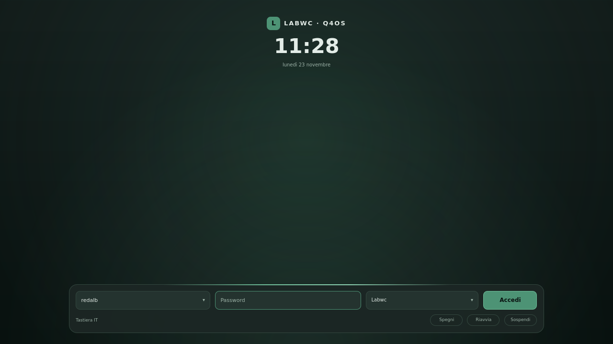 |

**Sincronizzazione con lo sfondo.** Nelle Preferenze c'è lo switch *Login con
gli stessi colori dello sfondo*: quando è attivo, cambiare tema desktop
(blu/rosso/verde) aggiorna automaticamente anche il login. Lo switch si trova
nello stesso pannello del cambio sfondo. Per scegliere una schermata diversa
dal tema, usa l'app **Schermata di login** (menu del tasto destro):

```bash
labwc-login-theme              # grafica: tre anteprime + switch
labwc-login-theme --show       # stato in JSON
labwc-login-theme --apply muted-crimson
```

L'applicazione al login richiede la password di root una sola volta
(`pkexec`); il cambio diventa effettivo al login successivo.

Al centro dello sfondo, dietro le card, il **logo reverseloop-dev** compare
**una sola volta, grande e centrato**, con **2 cm di margine a sinistra e a
destra**: monocromatico, tinto con il colore del tema (blu `#3b82f6`,
rosso `#c0565b`, verde `#4d9375`) e molto trasparente, come prima. Il PNG si
genera in `/usr/share/labwc-q4os/login-themes/<tema>/logo-pattern.png` con
`scripts/generate-login-logo.py` (Pillow, stessa maschera di luminanza degli
sfondi, seed fisso per tema: il risultato è sempre identico).


La tastiera del login è **IT** per impostazione predefinita: l'installer usa
`localectl`, `/etc/default/keyboard` e un fallback in
`/etc/X11/xorg.conf.d/00-keyboard.conf` per SDDM (X11); labwc usa
`XKB_DEFAULT_LAYOUT=it`. Per cambiare layout al login:

```bash
sudo localectl set-keyboard-layout it
# oppure it,us
```

### Se il login era Plasma o Breeze

Se SDDM era configurato dal desktop **Plasma** (tema Breeze o greeter Wayland),
l'installer lo rileva e scrive `/etc/sddm.conf.d/zz-labwc-q4os.conf`: essendo
l'ultimo drop-in, prevale sui file di Plasma e forza tema `labwc-q4os`,
`DisplayServer=x11` e sessione `labwc.desktop`.

La sessione Labwc usa anche un piccolo wrapper
`/usr/local/libexec/labwc-q4os/labwc-session`: imposta `HOME` e le variabili
XDG corrette, ripara la configurazione se manca (`labwc-doctor --fix`) e scrive
l'esito in `~/.local/state/labwc-q4os/session.log`. Il watchdog avvia Waybar o
Noctalia se non sono attive, senza ricaricare il desktop a ogni login: la
ricarica automatica con popup è stata rimossa perché superflua. Se serve,
**Ricarica menu e desktop** resta disponibile dal menu e con `Super+Shift+R`.

Se dopo l'installazione il login mostra ancora Plasma:
```bash
sudo systemctl restart sddm
# controllo dei file:
grep -R "Current=" /etc/sddm.conf /etc/sddm.conf.d 2>/dev/null
cat /usr/share/wayland-sessions/labwc.desktop
```

Se scegli di mantenere TDM, il tema SDDM viene comunque installato ma non
usato: TDM non supporta le sessioni Wayland. In quel caso avvia
`labwc` da TTY o reinstalla con `./install.sh --sddm`.

---

## Requisiti

- **Q4OS 6.x** (base Debian 13) oppure **Debian 13 o successiva**.
  Q4OS 5.x / Debian 12 **non** includono labwc nei repository: in quel caso
  l'installer si ferma con un messaggio chiaro prima di modificare il sistema.
- GPU e driver in grado di eseguire una sessione Wayland (Intel, AMD, NVIDIA
  con driver proprietari aggiornati).
- Utente normale con privilegi `sudo`. **Non eseguire lo script come root.**
- Connessione internet per i pacchetti `apt` (circa 300–500 MB).
- `git` per l'installazione one-liner.

La sessione Q4OS preesistente resta intatta: labwc viene aggiunto come voce
in `/usr/share/wayland-sessions`. Se è attivo **TDM** — che non supporta
Wayland — l'installer propone di installare e attivare **SDDM** (default sì),
mantenendo Trinity/Plasma selezionabili al login. Con `--keep-tdm` il display
manager non viene toccato; in tal caso si può avviare Labwc da TTY con
`dbus-run-session labwc`.

### Browser, estensioni e qpdfview

L'installer permette di scegliere con una breve descrizione:

1. **Chromium** — motore di Chrome, massima compatibilità con le web app;
   estensioni dal Chrome Web Store. Usa più RAM: scegli questo se le web app
   devono funzionare senza sorprese.
2. **Firefox ESR** (`firefox-esr`) — Firefox stabile e leggero: più privacy,
   estensioni dal catalogo Mozilla e meno RAM di Chromium. Consigliato sui PC
   datati.
3. **Entrambi** — installa Chromium e Firefox ESR, ognuno con le sue estensioni.
4. **Nessuno** — non installa e non modifica nessun browser.

Il browser scelto **non viene reinstallato** se è già presente. Se scegli un
browser diverso da quello già installato, l'installer chiede se **disinstallare
l'altro** (default: no). Con `--yes` o aggiornamento rapido non viene rimosso
nulla.

**Chromium** usa la policy
`/etc/chromium/policies/managed/labwc-q4os-extensions.json` e al primo avvio
installa dal Chrome Web Store:

- **uBlock Origin Lite** (`ddkjiahejlhfcafbddmgiahcphecmpfh`);
- **Privacy Badger** (`pkehgijcmpdhfbdbbnkijodmdjhbjlgp`);
- **enhanced-h264ify** (`omkfmpieigblcllmkgbflkikinpkodlk`).

**Firefox ESR** arriva dal repository Debian; il comando è `firefox-esr`. La
policy in `/etc/firefox-esr/policies/policies.json` (copiata anche in
`/usr/share/firefox-esr/distribution/`) aggiunge dal catalogo Mozilla:

- **uBlock Origin** (`uBlock0@raymondhill.net`);
- **Privacy Badger** (`jid1-MnnxcxisBPnSXQ@jetpack`);
- **enhanced-h264ify** (`9a41dee2-b924-4161-a971-7fb35c053a4a`).

In più limita i processi web a **2** (`dom.ipc.processCount`) e scarica le
schede in background quando la RAM è bassa
(`browser.tabs.unloadOnLowMemory`): meno memoria usata, a costo di un
isolamento leggermente minore tra le schede.

Entrambi i browser ricevono il preferito **YouTube 360p** (`https://youtube.it/`).
In Chromium l'estensione locale imposta la qualità a 360p; in Firefox ESR viene
installata la stessa estensione come XPI nella cartella `distribution`.

**enhanced-h264ify** è l'addon per i video. Di default blocca **AV1**, **VP9** e
**VP8** su YouTube: il sito serve così il flusso **H.264** (`avc1`), che quasi
tutte le GPU degli ultimi 15 anni decodificano in hardware. I **60fps** restano
attivi. Se il PC fatica ancora, apri l'icona dell'estensione e spunta
**Block 60fps**. Verifica: tasto destro sul player YouTube → **Statistiche per
nerd** → **Codecs** deve mostrare `avc1`, non `av01` o `vp09`. Se il browser è
aperto durante l'installazione, chiudilo e riaprilo per applicare la policy.

Flag: `--browser chromium|firefox|none`; restano validi `--chromium`,
`--firefox`, `--no-chromium` e `--no-browser`. Con `--skip-apt` il browser
non può essere installato, ma le estensioni vengono configurate se è già
presente.

Per YouTube è stato scelto **FreeTube**: client con interfaccia grafica,
installato dal pacchetto ufficiale `.deb`. È l’unica app YouTube inclusa:
niente SMTube o lettori WebKit obsoleti.

### Tasti volume e AVVIA CAGE

I tasti **volume su/giù/mute** vengono intercettati da `keyd` e funzionano
anche dentro Cage.

**Cos’è Cage e perché lo uso.** labwc è il desktop normale: barra, menu,
finestre, sfondo. **Cage** invece è un compositore minimale che mostra **una
sola applicazione a tutto schermo**, senza barra, senza menu e senza desktop.
Quando si avvia un’app in Cage, labwc viene **chiuso davvero** (non è una
finestra a schermo intero dentro labwc): restano in memoria solo Cage e l’app.
Ho scelto Cage per i PC vecchi e i Chromebook con poca RAM: un video o un
browser occupano quasi tutta la memoria disponibile, quindi Cage toglie di
mezzo tutto il resto. Alla chiusura dell’app, labwc riparte da solo. Poiché
labwc viene chiuso, **salva i documenti prima**: le modifiche non salvate
vanno perse.

Nel menu **TOOL reverseloop** la voce **AVVIA CAGE** chiude labwc e apre una
console dentro Cage: da lì si avviano direttamente:
```
chromium
firefox-esr
labwc-freetube-cage    # FreeTube con pulsante X o Ctrl+Shift+Q
```
Con i collegamenti **(cage)** labwc viene chiuso, l’app parte in Cage e, alla
chiusura, labwc riparte automaticamente. Dopo un aggiornamento dello script
serve **un logout/login una volta** per caricare il nuovo wrapper di sessione;
fino ad allora Cage usa il fallback annidato. La voce **FreeTube (cage)** chiede conferma prima
di chiudere labwc. Se lanci `cage` manualmente da una console, invece, resti
nella shell: usa `labwc-return` o `Ctrl+Alt+F1`.

Nella console di **AVVIA CAGE**, digitare `exit` chiude **definitivamente**
Cage e tutte le app rimaste, esattamente come la X di FreeTube: il wrapper di
sessione termina l’albero di processi e labwc riparte. Non serve più
`labwc-return` per questo caso. Salva i documenti aperti prima di uscire.

**Batteria in Cage (Ctrl+Alt+B).** Le app avviate in Cage — dal menu, dai
collegamenti *(cage)* o a mano con `labwc-cage` — passano da `labwc-cage-app`.
In Cage non esiste layer-shell e c'è un solo client, quindi il HUD viene
disegnato **dentro l'app** (`labwc-cage-hud`): Chromium, Chrome, Brave, Edge,
Vivaldi, Opera e FreeTube usano il **DevTools locale** su `127.0.0.1`;
**Firefox** usa il suo **WebDriver BiDi** (`--remote-debugging-port`).
Il riquadro è **visibile all'avvio** in basso a sinistra, con batteria,
percentuale e la combinazione accanto: `clicca o Ctrl+Alt+B per nascondere`
(verde, ambra sotto il 35%, rossa sotto il 15%; "in carica" se collegato;
"AC" senza batteria). Un **clic sul riquadro** lo ritrae verso sinistra con
un'animazione e lascia a vista una **linguetta** sottile; un clic sulla
linguetta lo riapre. Per tastiera **Ctrl+Alt+B** (e `Ctrl+.` come alias); dove
Alt+lettera apre i menu (Firefox) vale **Ctrl+Shift+.** (Ctrl+>).

**Addon batteria (Firefox e Chromium).** L'installer aggiunge anche un addon
(`addons/battery-hud`) che disegna lo stesso HUD **dentro ogni pagina**,
indipendente dal DevTools: mostra percentuale, stato di carica e **durata
stimata** (`≈ 3h 20m`, oppure `≈ 1h 10m al pieno` in carica), calcolata dal
native host `battery-native-host` leggendo `/sys/class/power_supply`.
- Firefox: XPI di distribuzione in `/usr/lib/firefox-esr/browser/extensions`,
  con pref di sistema che consente l'addon non firmato (ESR).
- Chromium/Chrome: estensione in `/usr/share/labwc-q4os/battery-hud/chromium`,
  caricata da `labwc-cage-app` con `--load-extension`.
- Native messaging dichiarato in `/usr/lib/mozilla/native-messaging-hosts` e
  `/etc/chromium|/etc/opt/chrome/native-messaging-hosts`.
Se l'addon è attivo, il HUD iniettato da `labwc-cage-hud` non viene duplicato
(marcatore `data-lbqc-ext`). Stesso clic/linguetta/Ctrl+Alt+B. Il HUD compare
anche sulla **nuova scheda** (pagina interna dell'addon) e lo stato "chiuso"
viene ricordato: se lo nascondi, resta nascosto anche aprendo altre pagine e
schede.

**Mouse in Cage.** Cage su DRM (accesso diretto alla scheda video) legge
direttamente mouse e tastiera: serve il backend `libinput` accanto a `drm` (`WLR_BACKENDS=drm,libinput`) e l’utente nel
gruppo `input`. L’installer aggiunge il gruppo quando installa Cage e usa il
cursore software. Serve un logout/login una volta dopo l’aggiornamento; senza
uno dei due requisiti le app in Cage non ricevono il puntatore, anche se Cage
si avvia.

**Touchpad.** Tap a due dita invia il **tasto destro**. Il click fisico usa
le aree del touchpad: **in basso a sinistra = sinistro**, **in basso a destra
= destro** (`tapButtonMap lrm`, `clickMethod buttonAreas`); vale anche per il
touchpad “Elan Touchpad” dei Chromebook. È configurato in `rc.xml` e si
applica con `labwc --reconfigure` o al login.

**Touchscreen.** Un dito è il click sinistro nativo. **Due dita = tasto
destro**, **tre dita = Esc**: serve a uscire dallo schermo intero di FreeTube
o del browser, sia in labwc sia in Cage, senza tastiera. Funziona tramite
`labwc-touch-tap` e `/dev/uinput` (un dispositivo virtuale; l’installer dà
accesso al gruppo `input`).

**Tornare a labwc dopo Cage.** Se lanci `cage` manualmente dalla console, il
wrapper mostra le istruzioni prima e dopo l'app. Dalla console non lanciare
`labwc`: il compositore è ancora attivo e il DRM risulta occupato. Usa:
```bash
labwc-return
```
Nella console di **AVVIA CAGE** basta invece `exit`: Cage e le app rimaste
vengono chiusi e labwc riparte da solo, come con la X di FreeTube.

In alternativa `Ctrl+Alt+F1` riporta al VT di labwc. `labwc-return` rileva il VT
della sessione attiva e ci ritorna; se labwc non è più attivo, riavvia SDDM.

**Perché al ritorno non chiede la password.** Cage chiude **labwc**, non la
sessione di login. SDDM resta fuori e il wrapper riavvia labwc nella stessa
sessione: non c’è stato un logout, quindi non c’è login da rifare. Restano
attivi solo i servizi della sessione utente (systemd, PipeWire, portali,
keyring), necessari alle app in Cage; labwc, Noctalia, Waybar, Mako, swaybg,
Xwayland e il controllo aggiornamenti vengono terminati. Per avere il login
serve un logout vero dalla sessione.

### FreeTube e Cage

FreeTube viene installato dal **repository APT dedicato** (GHaaAPT) o dal
pacchetto ufficiale GitHub: circa **100 MB**, niente Flatpak/Flathub. Se
FreeTube è già installato **non viene reinstallato**: l’installer confronta la
versione del PC con quella del repo e aggiorna solo se quella del PC è più
vecchia (nessun downgrade). Per evitare il loop **SABR** (un problema del sistema di streaming di YouTube,
che mostra “reloading player according to SABR request”), l’installer usa **FreeTube 0.23.15**, ultima versione senza SABR: verifica lo
SHA-256 e la blocca con `apt-mark hold`, quindi `apt upgrade` non la sostituisce
e il controllo aggiornamenti interno è disattivato. Per provare l’ultima
versione: `FREETUBE_PIN=latest ./install.sh` (può avere il bug SABR).
L’installer chiede se installarlo e crea **due** collegamenti, come per i browser:
**FreeTube** apre FreeTube in labwc con la normale X della finestra;
**FreeTube (cage)** chiede conferma (avvisa che labwc verrà chiuso e che i
file non salvati andranno persi), avvia FreeTube a schermo intero in Cage e
mostra una **X in alto a destra** per chiuderlo; alla chiusura labwc riparte
automaticamente. La X resta sempre in primo piano, anche durante la
riproduzione a schermo intero, sopra i menu e i dialoghi. In alternativa
funzionano **Ctrl+Shift+Q** e **Alt+F4**. La chiusura non dipende dalla
finestra di FreeTube: se l’app finisce nel tray o si blocca sulla chiusura,
il wrapper termina comunque il processo (prima `SIGTERM`, poi `SIGKILL`) e
labwc riparte. Se anche la pagina fosse completamente bloccata, usa
`Ctrl+Alt+F2` e da console `pkill -TERM -f freetube` (oppure riavvia). La
qualità video predefinita è **360p** in entrambe le modalità.

Per Chromium e Firefox ESR vengono creati due collegamenti: uno normale e uno
con suffisso **(cage)**, che usa lo stesso meccanismo a schermo intero. Se
scegli entrambi i browser, l’installer installa e configura entrambi.

Flag: `--freetube` / `--no-freetube`; `--both-browsers` per Chromium e
Firefox ESR insieme.

Firefox ESR arriva dal repository Debian e si aggiorna con
`apt update && apt upgrade`; Noctalia usa il repository APT del progetto.
Dopo un aggiornamento si aggiornano anche browser e shell.

**qpdfview** è proposto come lettore PDF leggero, adatto ai PC vecchi:
l'installer chiede se installarlo, non lo reinstalla se c'è già e non tocca le
associazioni dei file. Flag: `--qpdfview` / `--no-qpdfview`; con `--skip-apt`
la domanda non installa nulla.

### Touchscreen

Durante l'installazione lo script chiede se il PC ha un touchscreen; il
default è **sì** quando `labwc-touchscreen` trova un device con
`INPUT_PROP_DIRECT`. `--touch` / `--no-touch` saltano la domanda.

Con il touchscreen attivo l'installer:

- installa `wvkbd`, `lisgd`, `libinput-tools`, `wlr-randr`;
- aggiunge l'utente al gruppo `input` (serve un nuovo login per i gesti);
- scrive `~/.config/labwc/touchscreen.enabled`;
- imposta in `environment`: `QT_SCALE_FACTOR=1.25`, `GDK_SCALE=1`,
  `MOZ_USE_XINPUT2=1`;
- porta a 13 il font di `rc.xml` e a 44 px i pulsanti del titolo nel tema;
- all'avvio avvia `wvkbd-mobintl --hidden` e `lisgd`: **swipe dal bordo
  inferiore verso l'alto** mostra/nasconde la tastiera con `SIGRTMIN`.

Se `wvkbd` o `lisgd` non fossero disponibili nei repository, l'installer
avvisa e il resto della sessione resta invariato.

### Barra e launcher: Waybar + Fuzzel oppure Noctalia v5

Dopo la domanda sul touchscreen l'installer chiede come gestire barra,
launcher e notifiche. La scelta si può forzare con `--shell waybar|noctalia`
e si può cambiare in seguito rieseguendo l'installer con lo stesso flag.

| | **Waybar + Fuzzel** (default) | **Noctalia v5** |
|---|---|---|
| **Cosa è** | Componenti separati: Waybar, Fuzzel, Mako, swaybg | Una shell unica: barra, launcher, notifiche, centro di controllo, sfondo, lock |
| **Risorse** | Molto leggera su CPU, RAM e GPU; adatta a PC vecchi e VM | Nativa OpenGL ES, molto curata ma più esigente su RAM e GPU |
| **Grafica** | GTK3, colori del tema labwc-q4os | Pannelli e animazioni proprie, palette generata dallo sfondo |
| **Uso** | Ogni pezzo è indipendente; Fuzzel e Zenity servono anche agli strumenti del progetto | Esperienza integrata e moderna, con impostazioni grafiche unificate |
| **Installazione** | Pacchetti Debian standard | Repository APT di terze parti `pkg.noctalia.dev`, solo Debian/Q4OS amd64/arm64 |
| **Configurazione** | File del progetto (`configs/`) già pronti | `~/.config/noctalia/config.toml`, hot-reload |

In modalità Noctalia l'installer aggiunge il repository ufficiale del progetto
Noctalia, installa il pacchetto `noctalia`, imposta i tasti launcher
(`Super+D`, `Super+Spazio`, `Alt+F2`) su Noctalia e usa
`[theme] source = "wallpaper"` così la palette segue lo sfondo del tema attivo.
Imposta anche la **cartella sfondi del progetto**
(`~/.local/share/labwc-q4os/wallpapers`) come directory del picker Noctalia,
così i tre sfondi compaiono nella galleria; al login applica lo sfondo del tema
corrente. **Waybar, Mako e Fuzzel vengono rimossi** (con Fuzzel assente,
gli strumenti del progetto usano Zenity come selettore); `swaybg` resta solo
come sfondo immediato finché Noctalia non è pronta, poi viene fermato. Se
l'installazione di Noctalia fallisce (rete, architettura, repository non
raggiungibile) vengono reinstallati e attivati Waybar + Mako + swaybg, senza
interrompere il resto.

Per velocizzare il login su VM e reti lente, l'installer scrive anche
`~/.config/noctalia/99-labwc-q4os.toml` con `offline_mode = true`: niente
template/palette community, meteo o tassi di cambio all'avvio; la cartella
sfondi resta quella del progetto. Su macchine **senza adattatore Bluetooth**
il servizio `bluetooth` viene mascherato: BlueZ non può partire e senza questo
Noctalia aspetterebbe 25 secondi il D-Bus a ogni login. Con un adattatore il
servizio resta normale.

Con un adattatore il Bluetooth parte **spento**: l'installer applica un
soft-block `rfkill` solo se non esiste già una scelta salvata. La scelta vive
in `/var/lib/labwc-q4os/bluetooth` e viene riapplicata in tre momenti: dalla
regola udev quando l'adattatore compare, dal servizio di boot
`labwc-q4os-bluetooth.service` (dopo `systemd-rfkill` e `bluetooth.service`,
così nessuno dei due può riaccenderlo) e da `labwc-bluetooth` quando cambi
scelta. Vale anche se l'adattatore viene enumerato tardi al boot. Se lo accendi
(menu *TOOL reverseloop > Bluetooth*, `labwc-bluetooth on` o `bluetoothctl`)
al riavvio resta acceso, e se lo spegni resta spento.

Vale anche il contrario: scegliendo **Waybar + Fuzzel** viene rimosso il
pacchetto `noctalia`. Le configurazioni restano, così puoi cambiare idea
rieseguendo l'installer con `--shell`. La sessione avvia **una sola shell**:
al login viene fermata l'eventuale shell precedente. Un watchdog nel wrapper
di sessione controlla dopo pochi secondi che la barra scelta sia attiva; se
l'autostart non è partito, avvia `labwc-session-start` una volta. Così sfondo
e barra compaiono da soli, senza dover riaprire il selettore sfondi.

> Noctalia è un progetto indipendente: il repository APT è di terze parti.
> Se preferisci ridurre le dipendenze esterne, resta sul default
> Waybar + Fuzzel.

### LookSwitcher per Trinity (solo Trinity)

Se sul sistema è presente **Trinity** (la sessione classica di Q4OS), dopo la
scelta della shell l'installer chiede se installare **LookSwitcher**, il
selettore di temi del desktop Q4OS Trinity
([q4os-trinity/q4os-desktop](https://github.com/q4os-trinity/q4os-desktop)),
con una breve descrizione. **Riguarda solo Trinity e non modifica labwc**, che
continua a usare i suoi tre temi blu/rosso/verde.

- pacchetto cercato: `lookswitcher-trinity`, fallback `lookswitcher`;
- se i repository Q4OS non lo forniscono, nessuna modifica e avviso;
- `--lookswitcher` / `--no-lookswitcher` per non ricevere la domanda;
- la domanda viene saltata se Trinity non è installato o con `--skip-apt`.

---

## Installazione

### One-liner

```bash
curl -fsSL --proto '=https' --proto-redir '=https' --tlsv1.2 https://raw.githubusercontent.com/reverseloop-dev/labwc-q4os/main/bootstrap.sh | bash
```

Con opzioni:

```bash
curl -fsSL --proto '=https' --proto-redir '=https' --tlsv1.2 https://raw.githubusercontent.com/reverseloop-dev/labwc-q4os/main/bootstrap.sh \
  | bash -s -- --theme blue --yes
```

### Manuale

```bash
git clone https://github.com/reverseloop-dev/labwc-q4os.git
cd labwc-q4os
./install.sh
```

### Opzioni

<details>
<summary>Mostra i dettagli tecnici</summary>


| Opzione | Effetto |
|---|---|
| `--theme blue\|red\|green` | Tema iniziale: `nordic-cobalt`, `muted-crimson`, `sage-emerald` |
| `--theme nordic-cobalt` | Nome completo del tema |
| `--yes` | Nessuna domanda: zram e swappiness attivi, tema corrente o blu |
| `--zram` / `--no-zram` | Attiva/disattiva zram senza prompt |
| `--keyboard LAYOUT` | Layout labwc/login: `it`, `us`, `it,us` (default rilevato) |
| `--touch` / `--no-touch` | Installa o esclude tastiera su schermo e gesti touch |
| `--shell waybar\|noctalia` | Barra/launcher: Waybar+Fuzzel (default) o Noctalia v5 |
| `--lookswitcher` / `--no-lookswitcher` | Selettore temi LookSwitcher per Trinity (solo Trinity) |
| `--browser chromium\|firefox\|both\|none` | Sceglie uno o entrambi i browser e le estensioni |
| `--chromium` / `--firefox` | Scorciatoie per `--browser chromium` / `firefox` |
| `--no-chromium` / `--no-browser` | Nessun browser (compatibilità) |
| `--qpdfview` / `--no-qpdfview` | Installa o esclude qpdfview, lettore PDF leggero |
| `--freetube` / `--no-freetube` | Installa o esclude FreeTube 0.23.15 (senza SABR) |
| `--both-browsers` | Installa sia Chromium sia Firefox ESR |
| `--quick` | Aggiorna subito con le opzioni salvate, senza domande |
| `--configure` | Chiede comunque tutti i parametri prima di aggiornare |
| `--swappiness N` | Imposta `vm.swappiness` a `N` (0–200) |
| `--no-swappiness` | Non modificare `vm.swappiness` |
| `--restore` | Ripristina l'ultimo backup e termina senza installare |
| `--no-restore` | Salta la domanda sul ripristino |
| `--sddm` | Installa e attiva SDDM se TDM non supporta Wayland |
| `--keep-tdm` | Non toccare il display manager |
| `--skip-apt` | Salta l'installazione pacchetti (solo configurazione) |
| `--force-os` | Procede anche su distribuzioni non Debian |
| `--help` | Aiuto |

**Tutte le domande sono all'inizio**, prima di `sudo` e di qualsiasi modifica.
Nelle installazioni normali, se c'è un display, le scelte di installazione
(browser, shell, zram, swappiness, touchscreen, LookSwitcher, qpdfview,
qpdfview) si fanno in un **wizard GTK**: pagine colorate, checkbox e pulsanti Indietro/Avanti; la shell completa con le
domande rimanenti. Con `--yes`, `--quick` o qualsiasi flag esplicito la GUI
non viene aperta. Per saltarla anche in modalità grafica:
`LABWC_Q4OS_NO_GUI=1`. Dopo il riepilogo parte l'installazione con le scelte
fatte; con `--yes` non viene chiesto nulla e si usano i default.

La **prima domanda** è il **ripristino**: *“Ripristinare la configurazione
dall'ultimo backup?”* (default **No**). Rispondendo sì lo script rimette i file
com'erano prima dell'ultimo aggiornamento e termina; `--restore` lo fa senza
domanda, `--no-restore` la salta. Subito dopo, se c'è un'installazione
precedente, arriva la domanda *“Vuoi modificare i parametri prima di
aggiornare?”*:
- **Sì** → vengono chieste le opzioni qui sotto;
- **No** → aggiornamento rapido con le opzioni salvate in
  `/etc/labwc-q4os/install-options`: nessuna domanda, solo la password `sudo`.

1. **layout tastiera** — rilevato dal sistema (`it`, `us`, `it,us`), saltato
   con `--keyboard` o `--yes`.
2. **zram** — RAM compressa con `zstd`, 50% della RAM. Migliora la reattività
   soprattutto su macchine con 2–8 GB.
3. **swappiness** — parametri `vm.swappiness` e `vm.vfs_cache_pressure`
   persistenti in `/etc/sysctl.d/99-labwc-performance.conf`.
4. **touchscreen** — se il PC ha un pannello touch, installa tastiera su
   schermo e gesti (default sì se viene rilevato).
5. **LookSwitcher** — solo se Trinity è installato: selettore di temi per la
   sessione Trinity; non tocca labwc.
6. **shell desktop** — Waybar + Fuzzel (default, leggero) oppure Noctalia v5
   (shell integrata, più risorse; repository APT di terze parti).
7. **display manager** — solo se è attivo TDM: propone SDDM per rendere
   Labwc selezionabile al login (TDM resta installato).
8. **tema iniziale** — blu Nordic Cobalt, rosso Muted Crimson o verde Sage
   Emerald.
9. **browser** — Chromium, Firefox ESR, entrambi o nessuno, con una riga che spiega a cosa
   serve ciascuno. Il browser scelto non viene reinstallato; se l'altro è già
   installato, chiede se disinstallarlo (default no). Le tre estensioni vengono
   configurate automaticamente.
10. **qpdfview** — solo se non è già installato: chiede se aggiungere il lettore
    PDF leggero. Non cambia le associazioni dei file e non reinstalla nulla.

Scelta tecnica trasparente: con zram lo swap avviene in RAM compressa, quindi
`vm.swappiness=100` è desiderabile e non consuma il disco. Senza zram il
valore scende a `10` per evitare swap su disco prematuri. In entrambi i casi
`vm.vfs_cache_pressure=50` mantiene in cache inode e dentry, riducendo il
lavoro del disco. Con zram viene anche impostato `vm.page-cluster=0`, ottimale
per la compressione in RAM.

zram viene configurato anche se scegli di non attivarlo: potrai accenderlo e
spegnerlo in qualsiasi momento dal pannello grafico **ZRAM — memoria
compressa** nel menu del tasto destro, con indicatori di uso, compressione,
swap e RAM in tempo reale.

Al termine, se SDDM è stato attivato riavvia il sistema e scegli **Labwc**
dal login. Con TDM: **Menu → Session Type → Labwc** (se disponibile).

I comandi `labwc-*` sono installati in `~/.local/bin`, che Debian/Q4OS
aggiunge al `PATH` al login. Se il tuo profilo non lo fa:

```bash
export PATH="$HOME/.local/bin:$PATH"
```

---

</details>

## Dopo l'installazione

Al primo login partono automaticamente:

- con **Waybar + Fuzzel** (default): sfondo del tema (`swaybg`), Waybar,
  Mako per le notifiche;
- con **Noctalia v5**: la shell Noctalia, che gestisce barra, launcher,
  notifiche, centro di controllo e sfondo (Waybar/Mako/swaybg non partono);
- in entrambi i casi: `nm-applet`, `lxpolkit` e la cronologia appunti con
  `cliphist` (se installato).

### Tasti rapidi

`Super` è il tasto Windows/Logo.

| Combinazione | Azione |
|---|---|
| `Super + Invio` | Terminale Terminator |
| `Super + D` | Launcher: Noctalia (se scelto) o Fuzzel |
| `Super + Spazio` / `Alt + F2` | Launcher Fuzzel |
| `Super + E` | File manager (pcmanfm) |
| `Super + Q` / `Alt + F4` | Chiudi finestra |
| `Super + A` | Massimizza / ripristina |
| `Super + F` | Schermo intero |
| `Super + Frecce` | Snap a sinistra/destra/alto/basso |
| `Super + Tab` / `Alt + Tab` | Finestra successiva |
| `Super + 1…4` | Vai al desktop |
| `Super + Shift + 1…4` | Sposta finestra sul desktop |
| `Super + Shift + R` | Ricarica menu, tema e Waybar |
| `Super + Shift + T` | Cambia tema |
| `Super + Shift + M` | Editor app del menu |
| `Super + Shift + H` | Guida completa |
| `Stampa` / `Super + Shift + S` | Screenshot area (grim + slurp) |
| `Super + Stampa` | Screenshot schermo intero |
| `Super + L` | Blocca schermo |
| `Super + Ctrl + L` | Menu sessione |
| Tasti volume/luminosità | Audio e brightnessctl |

Tasto destro sul desktop: menu completo. **Doppio clic sinistro sul desktop:**
guida, scorciatoie e informazioni di sistema (versioni, tema, repo, ultimo
aggiornamento). Tasto destro sul titolo: menu della finestra. Rotellina sul
desktop: cambia desktop.

---

## Temi

| Tema | Palette | Carattere |
|---|---|---|
| **Nordic Cobalt** | `#1e293b` · `#3b82f6` | Blu profondo, riposante, tech |
| **Muted Crimson** | `#261c1e` · `#c0565b` | Rosso spento, caldo, sofisticato |
| **Sage Emerald** | `#1b2624` · `#4d9375` | Verde salvia, equilibrato, naturale |

Il cambio tema aggiorna in tempo reale:

- `themerc-override` di labwc (bordi, titoli, menu, OSD, snap overlay);
- `~/.config/waybar/style.css`;
- `~/.config/fuzzel/fuzzel.ini`;
- `~/.config/mako/config`;
- `~/.config/wlogout/style.css`;
- lo sfondo del desktop.

Comandi:

```bash
labwc-theme-switcher                 # selettore Fuzzel/Zenity
labwc-theme-switcher nordic-cobalt   # cambio diretto
labwc-theme-switcher muted-crimson
labwc-theme-switcher sage-emerald
```

Gli sfondi 2560×1440 sono **pre-generati e inclusi nel repository**
(`configs/wallpapers/`): l'installazione li **copia** in pochi istanti, senza
rigenarli ogni volta. Sono stati creati una volta con
`scripts/generate-wallpapers.py` (Pillow: gradienti mesh, geometrie sottili,
grana e vignettatura). Nessun link esterno, nessuna licenza di terzi.

Rigenerazione manuale, se vuoi crearli da zero:

```bash
labwc-generate-wallpapers
```

Le immagini finiscono in `~/.local/share/labwc-q4os/wallpapers/`.

### Logo al centro degli sfondi

I tre sfondi integrano il logo **reverseloop-dev** al centro, semitrasparente
e **tono su tono** con il colore dello sfondo. Il logo è nel generatore
(`scripts/generate-wallpapers.py`) e viene ritinto per ogni tema; i file sono
in `configs/wallpapers/`.

| Nordic Cobalt | Muted Crimson | Sage Emerald |
|---|---|---|
| 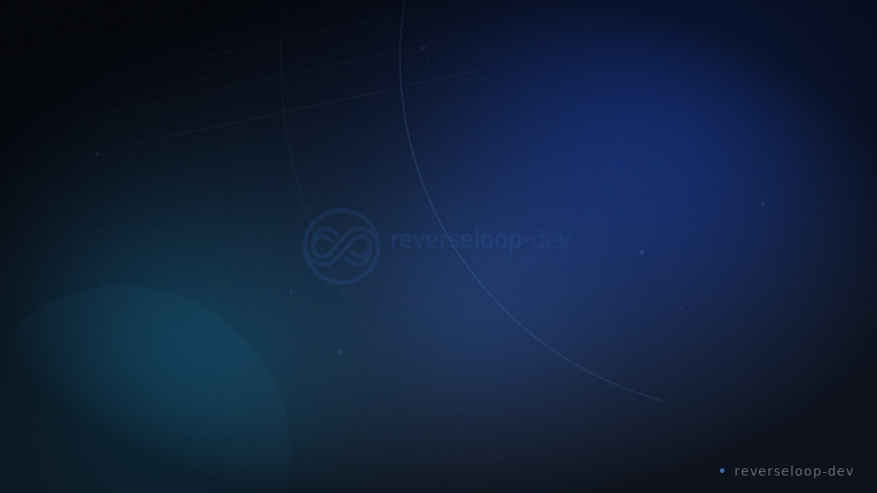 | 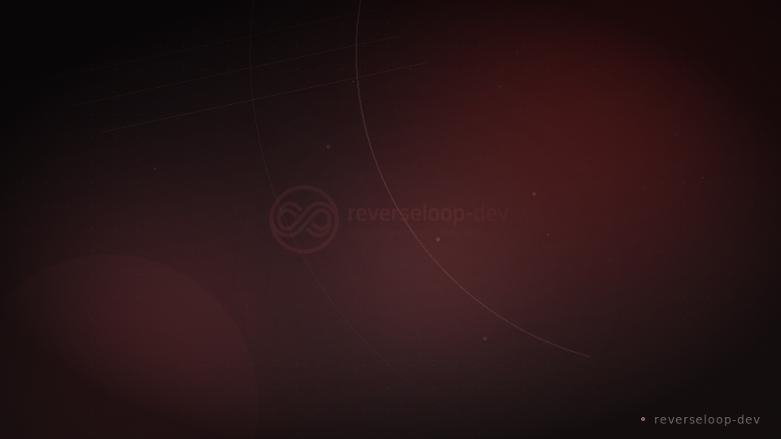 | 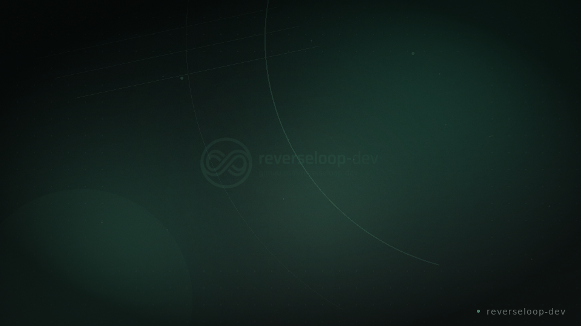 |

### Icone coordinate al tema

Ogni tema ha un set di icone SVG **originali**, moderne e stilizzate, disegnate
localmente e colorate con la palette attiva: blu per Nordic Cobalt, rosso
spento per Muted Crimson, verde salvia per Sage Emerald. Non vengono scaricate
da repository esterni, quindi non ci sono dubbi di licenza o link che possano
rompersi.

Il set copre terminale, file manager, browser, impostazioni, audio, rete,
batteria, sessione, screenshot, monitor, tema, ricerca, cartelle, documenti,
categorie, **cartella Home, Scrivania, Cestino**, dischi, azioni (indietro,
avanti, aggiorna, copia, incolla, elimina) e tipi di file comuni. Viene
applicato a:

- icone GTK: **GSettings** `org.gnome.desktop.interface icon-theme=labwc-q4os`
  (con `gtk-icon-theme-name` in `settings.ini` come fallback). Su Wayland
  `settings.ini` da solo non basta: senza GSettings PCManFM resta su Adwaita;
- taskbar di Waybar;
- Fuzzel;
- Mako;
- finestre di ZRAM e App nel menu Labwc.

Al cambio tema il symlink `~/.local/share/icons/labwc-q4os` punta al set del
nuovo tema; Waybar viene riavviata. Se PCManFM era già aperto, chiudilo e
riaprilo per vedere subito le nuove icone.

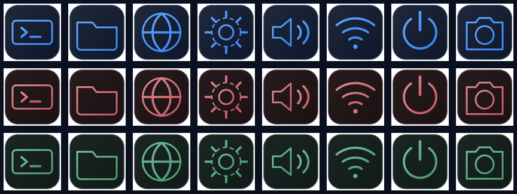

---

## Menu del tasto destro

Il menu e' generato dinamicamente da `scripts/render-menu.py` leggendo i file
`.desktop` installati:

1. **★ App preferite** — scelte dall'utente, in cima al menu.
2. **Categorie** — Internet, Multimedia, Grafica, Ufficio, Sviluppo, Giochi,
   Istruzione, Scienza, Sistema, Impostazioni, Accessori, Altre applicazioni.
   Il sottomenu **Impostazioni** raggruppa le app in **Aspetto e desktop**,
   **Schermo e hardware**, **Sistema e sessione** e **Altre impostazioni**.
3. **TOOL reverseloop** — poche voci in chiaro (AVVIA CAGE, Preferenze della
   scrivania, Aiuto) e sottomenu **App e menu**, **Cambia tema**,
   **Desktop 1–4**, **Schermo e monitor**, **Sessione**, **Sistema e
   diagnostica**. Così il menu resta corto e le ultime voci non vengono
   tagliate.

### App nel menu, preferite e categorie

Fuzzel **non supporta menu contestuali per singola voce**: il tasto destro su
un'app dentro Fuzzel non può essere intercettato. Per ottenere la stessa
funzione c'è **App nel menu Labwc** (`labwc-app-manager`), apribile da:

- tasto destro sull'icona launcher di Waybar;
- menu desktop → **TOOL reverseloop → Gestisci app e preferite**;
- ricerca Fuzzel: “App nel menu Labwc”.

Qui il **tasto destro su una riga** permette di:

- **Aprire** l'app;
- **Aggiungere ai preferiti**;
- **Spostare in categoria** (Multimedia, Internet, Grafica, Ufficio, ...);
- **Rimuovere dai preferiti**;
- **Ripristinare la categoria automatica**.

La rimozione delle preferite si fa **solo da questa app**: il sottomenu
“Rimuovi dai preferiti...” è stato rimosso dal menu desktop. In basso
nell'app c'è il promemoria: *pulsante destro su un'app per le opzioni*.

### Preferenze della scrivania e desktop

Tasto destro → **TOOL reverseloop → Preferenze della scrivania Labwc** apre un unico
pannello per:

- scegliere il tema e quindi icone, Waybar, Fuzzel, sfondo;
- impostare la tastiera `it`, `us` o `it,us`;
- selezionare i desktop **1–4**;
- scegliere la **posizione dell'indicatore batteria** (sinistra, centro,
  destra), se mostrare la percentuale e se mostrare l'icona;
- scegliere se la barra di **Waybar o Noctalia** sta in **alto o in basso**;
- aprire ZRAM, aggiornamenti, App nel menu e aiuto.

La Waybar mostra inoltre l'indicatore **`[1] 2 3 4`**: click sull'indicatore per
scegliere il desktop. I desktop restano selezionabili anche con `Super + 1…4` e
con la rotellina sul desktop.

### Scala dello schermo

**TOOL reverseloop → Schermo e monitor → Scala dimensioni dello schermo**
(comando `labwc-screen-scaler`) apre il port in **Rust** del *Screen scaling*
di Q4OS, riscritto per Wayland/labwc. La logica è quella originale: rileva il
DPI del monitor primario da `wlr-randr`, **due slider identici** da **0 a 20**
con **10 = 1.0×** al centro: il primo per le **finestre**, il secondo per il
**menu**. Opzioni avanzate con righello in cm e anteprima, pulsanti
**Defaults / Apply / Cancel**. Sotto 10 si rimpicciolisce, sopra 10 si
ingrandisce. Il menu e i titoli delle finestre vengono riscritti in
`~/.config/labwc/rc.xml` e `~/.config/labwc/themerc-override`, quindi il
cambio vale anche per il menu del tasto destro.

- **Apply** salva la scala in `~/.config/labwc/screen-scale.conf` e aggiorna il
  blocco gestito dentro `~/.config/labwc/environment` (`Xft.dpi`, `GDK_SCALE`,
  `GDK_DPI_SCALE`, `QT_SCALE_FACTOR`, `XCURSOR_SIZE`). Le modifiche valgono al
  login successivo, come nel tool TDE originale.
- **Defaults** chiede conferma e riporta tutto ai valori di sistema.
- Da terminale: `labwc-screen-scaler --status`, `--probe`, `--apply 8`
  (valore 8 = 0.8×), `--reset`, `--self-test`.

Il tool è compilato dall'installer con `rustc` (nessuna dipendenza oltre a GTK3,
già presente): il sorgente è `tools/labwc-screen-scaler.rs`.

Le finestre usano decorazioni lato server di labwc con i tre pulsanti classici
**riduci a icona, ingrandisci, chiudi**; `GTK_CSD=0` evita che le app GTK
sostituiscano la barra con decorazioni client-side.


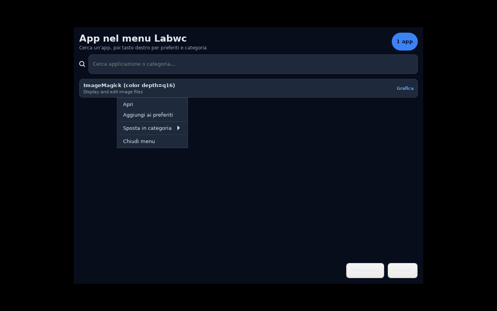

### Aggiungere o rimuovere app

Tasto destro → **TOOL reverseloop** → **Gestisci app e preferite**
(oppure `Super + Shift + M` per l'editor rapido Fuzzel).

L'editor usa Fuzzel (`--dmenu`) su Wayland, con fallback a Zenity e Whiptail.
Legge:

- `/usr/share/applications`
- `/usr/local/share/applications`
- `~/.local/share/applications`
- esportazioni Flatpak
- Snap desktop entries

Ad ogni modifica:

1. `~/.config/labwc/favorites.tsv` viene aggiornato;
2. `menu.xml` viene rigenerato;
3. `labwc --reconfigure` applica il menu immediatamente.

`favorites.tsv` sopravvive agli aggiornamenti e alle reinstallazioni.
Il menu e' già aggiornato: non serve riavviare la sessione.

### Ricarica manuale

Voce **Ricarica menu e desktop** oppure `Super + Shift + R`:

- `labwc --reconfigure`;
- riavvio di Waybar;
- `makoctl reload`.

---

## Aiuto integrato

`Super + Shift + H`, doppio clic sinistro sul desktop, oppure tasto destro →
**Aiuto, scorciatoie e sistema**, apre una guida italiana con:

- tutti i tasti rapidi;
- uso di Fuzzel e modalità `--dmenu`;
- percorso e scopo di ogni file di configurazione;
- esempi per modificare `rc.xml`, `style.css`, `fuzzel.ini`, `mako/config`,
  `autostart` e `environment`;
- comandi di ricarica e troubleshooting;
- gestione screenshot e cronologia appunti;
- versione script, data di installazione, versioni delle app, tema, sessione
  e link al repository.

Il file sorgente è `~/.config/labwc/help.txt`.

---

## Tastiera italiana e layout di login

Durante l'installazione viene rilevato il layout del sistema e della lingua.
Con locale italiano il default è **`it`**; è possibile scegliere anche
`us` o `it,us` (Alt+Shift per passare da uno all'altro).

```bash
./install.sh --keyboard it
./install.sh --keyboard it,us
```

Vengono configurati:

- `~/.config/labwc/environment` → `XKB_DEFAULT_LAYOUT=it` (e opzioni di switch);
- `/etc/default/keyboard` e `localectl` → layout del login/console (TDM, SDDM, TTY).

Per modificare solo labwc:

```text
~/.config/labwc/environment
  XKB_DEFAULT_LAYOUT=it
  # XKB_DEFAULT_OPTIONS=grp:alt_shift_toggle   # solo per it,us
```

Poi `Super+Shift+R` o `labwc --reconfigure`. Per il login:

```bash
sudo localectl set-keyboard-layout it
# oppure
sudo dpkg-reconfigure keyboard-configuration
```

---

## ZRAM — memoria compressa

Pannello grafico: tasto destro → **TOOL reverseloop** → **ZRAM — memoria
compressa**, oppure `labwc-zram`.

Mostra in tempo reale:

- stato **attivo / non attivo** e avvio automatico del servizio `zramswap`;
- barra della RAM di sistema e barra dello swap su zram;
- rapporto di compressione e RAM realmente occupata da zram;
- grafico dell'occupazione degli ultimi 3 minuti;
- dispositivo, algoritmo (`zstd`), dimensione, `vm.swappiness`.

Pulsanti **Attiva zram** e **Disattiva zram**: eseguono `systemctl
enable/disable --now zramswap` tramite `pkexec` e l'agente polkit della
sessione. L'attivazione abilita anche zram all'avvio.

Da terminale:

```bash
labwc-zram --status
labwc-zram --enable
labwc-zram --disable
```

Configurazione: `/etc/default/zramswap` (`ALGO=zstd`, `PERCENT=50`,
`PRIORITY=100`). L'installer scrive sempre questa configurazione, anche se
scegli di non attivare subito zram.


> Nota: il pannello è stato verificato in ambiente Debian 13 con Python
> PyGObject/GTK3. Se GTK non è disponibile, `labwc-zram --status` resta
> utilizzabile e l'installer segnala la dipendenza mancante.

---

## Controllo aggiornamenti

All'avvio di labwc, **se il controllo è abilitato**, `labwc-update-check`
attende la connessione internet e confronta:

- la versione installata in `~/.local/share/labwc-q4os/version-info`;
- la versione online `VERSION` del repository GitHub.

Se la versione online è più recente compare un **popup** con
installata/disponibile che **si chiude da solo dopo 15 secondi**. Sotto il
testo ci sono tre pulsanti:

- **Chiudi** → chiude subito il popup senza fare nulla;
- **Copia stringa shell** → copia negli appunti:
  ```bash
  curl -fsSL --proto '=https' --proto-redir '=https' --tlsv1.2 https://raw.githubusercontent.com/reverseloop-dev/labwc-q4os/main/bootstrap.sh | bash
  ```
- **Apri app per aggiornare** → apre il pannello (`labwc-update-gui`) e avvia
  il terminale con il comando di aggiornamento.

L'aggiornamento è **interattivo**: `labwc-update-run` apre Terminator (o foot,
x-terminal-emulator, konsole) ed esegue subito
`curl -fsSL .../bootstrap.sh | bash`. L'installer **rifà tutte le domande**
(tema, shell Waybar/Fuzzel o Noctalia, touchscreen, LookSwitcher, SDDM), quindi
le nuove scelte vengono applicate. Il terminale resta aperto alla fine per
leggere eventuali errori.

Se non è disponibile alcun terminale grafico, il pannello usa il vecchio
aggiornamento in-app (`pkexec` + barra di avanzamento + log) come fallback.
Il controllo non installa nulla da solo: l'aggiornamento parte sempre da
un'azione esplicita dell'utente. Se GTK non è disponibile, viene usata una
notifica Mako persistente.

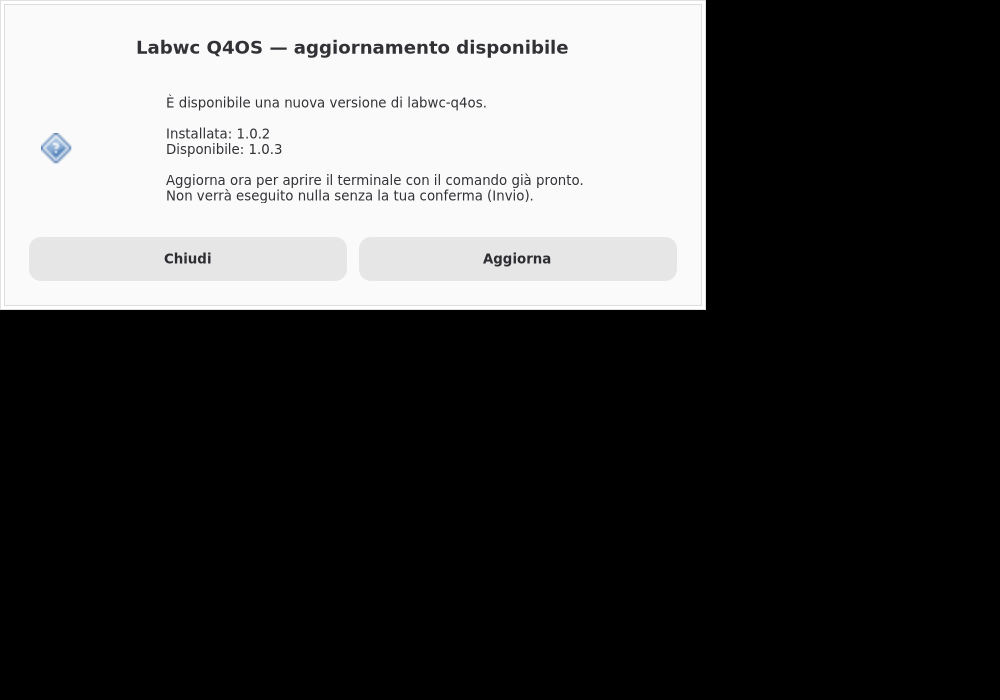

Il controllo ha un pannello dedicato:
tasto destro → **TOOL reverseloop → Controlli aggiornamenti script labwc-q4os**
(`labwc-update-gui`), separato da ZRAM.

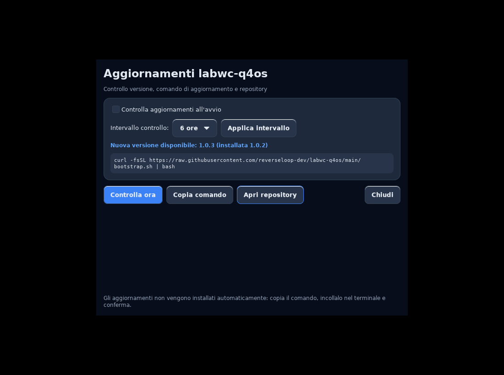

- check **Controlla aggiornamenti all'avvio** → l'utente normale può
  **disattivare** subito; per **riattivare** serve la password di root
  (`pkexec` + helper installato root-owned);
- intervallo predefinito **6 ore**, modificabile da 1 a 24 ore;
- **Aggiorna ora** → prima esegue un controllo versione; se la versione
  installata è uguale a quella online mostra un avviso “già installata”, se è
  nuova chiede se copiare il comando o aprirlo nel terminale (dove l'installer
  rifà le domande);
- **Controlla ora** → verifica immediata;
- **Copia comando** → copia il bootstrap negli appunti;
- **Apri repository**;
- stato ultimo controllo / nuova versione visibile nel pannello.

Da terminale:

```bash
labwc-update-check --status
labwc-update-check --once
labwc-update-check --enable    # chiede la password di root
labwc-update-check --disable   # disattivazione utente, senza password
labwc-update-check --set-interval 21600
```

Lo stato è salvato in:

```text
/etc/labwc-q4os/update-check.enabled        # flag root
~/.config/labwc/update-check.disabled       # disattivazione utente
~/.config/labwc/update-check.interval       # intervallo in secondi
~/.local/state/labwc-q4os/update-status.json
```

---

## Backup e ripristino

Ogni aggiornamento mette da parte **un solo backup**: la fotografia della
configurazione com'era *prima* di essere toccata. Il backup nuovo sostituisce
quello vecchio, quindi la cartella non cresce a ogni aggiornamento e non
riempie il disco.

- **Dove**: `~/.local/state/labwc-q4os/backups/` (una sola cartella, la più recente).
- **Quando**: all'inizio dell'installazione, prima che l'installer scriva
  qualsiasi file.
- **Cosa salva**: tutte le configurazioni che l'installer può modificare —
  `labwc`, `waybar`, `fuzzel`, `mako`, `wlogout`, `gtk-3.0`, `gtk-4.0` in
  `~/.config`, le scorciatoie `.desktop` del progetto e i file di sistema
  (GRUB, tastiera, zramswap, sysctl, keyd, policy di Chromium e Firefox).

**Ripristino, dall'ultimo backup.** È la **prima domanda** dell'installer e
il default è **No**:

```text
Ripristinare la configurazione dall'ultimo backup? [s/N]   -> No
```

Rispondendo **sì** — oppure con `./install.sh --restore` — tutti i file
registrati nel backup tornano al loro posto e lo script **termina senza
installare nulla**. `--no-restore` salta la domanda; `--yes` non chiede nulla.
Dopo il ripristino, esci e rientra nella sessione per applicare la
configurazione.

<details>
<summary>Dettagli tecnici (manifest, formati vecchi, permessi)</summary>

Il backup contiene un `manifest.tsv` con una riga per voce:
`tipo<TAB>percorso_nel_backup<TAB>percorso_originale`. Il ripristino usa il
manifest, quindi copre **tutti i file interpellati** e non solo `~/.config`:
cartelle (sostituite in blocco) e singoli file di sistema (scritti con `sudo`).
I backup creati dalle versioni precedenti, senza manifest, vengono riconosciuti
dai nomi noti (`config/*`, `system/grub.default`, `system/keyboard`,
`system/zramswap`, `system/99-labwc-performance.conf`,
`system/keyd-default.conf`, `system/zz-labwc-q4os-chromium`,
`system/labwc-q4os-extensions.json`,
`system/firefox-esr-distribution-policies.json`).

La nuova copia viene preparata e solo dopo la vecchia viene rimossa
(`backup_ensure` → `prune_backups`), così un aggiornamento interrotto non
lascia mai il sistema senza backup. Il ripristino **sovrascrive** lo stato
attuale con quello del backup: le modifiche fatte dopo l'ultimo aggiornamento
vanno perse.

</details>

## Labwc Doctor

Controlli automatici e riparazione:

```bash
labwc-doctor
labwc-doctor --fix
labwc-doctor --fix-system
```

Verifica:

- labwc e versione minima;
- comandi essenziali e opzionali;
- `/dev/dri`, sessione Wayland e processi Waybar/Mako/swaybg;
- `XDG_RUNTIME_DIR` e permessi;
- XML di `rc.xml` e `menu.xml`, JSON di Waybar, token CSS non risolti;
- tema, sfondo, menu, preferite, Waybar, Fuzzel, Mako, wlogout;
- sessione `/usr/share/wayland-sessions/labwc.desktop`;
- display manager e supporto Wayland;
- XWayland e portali;
- zram, `vm.swappiness`, `vm.vfs_cache_pressure`;
- errori recenti in `~/.local/state/labwc-q4os/session.log`.

`--fix` ripristina i file utente mancanti dai template, rigenera tema e menu,
ricrea lo sfondo e ricarica il desktop. `--fix-system` ripristina anche la
sessione Wayland con `sudo`. Dal menu: **TOOL reverseloop → Diagnostica e
ripara desktop**.

---

## Waybar

Moduli attivi:

| Modulo | Interazione |
|---|---|
| Launcher icona menu | Click: Fuzzel · tasto destro: App nel menu Labwc |
| Taskbar | Click: attiva · centrale: chiude · destro: fullscreen |
| Orologio | Click: calendario · tooltip: mese |
| Tray | Applicazioni di sistema |
| Audio | Click: `pavucontrol` |
| Rete | Click: `nm-connection-editor` |
| Batteria | Dettagli con `upower` (se presente) |
| CPU / RAM | Utilizzo in tempo reale |
| icona sessione | Click: menu sessione · destro: swaylock |

La posizione della barra (alto o basso) si sceglie da **Preferenze della
scrivania Labwc** ed è salvata in `~/.config/labwc/bar-position`: vale sia per
Waybar sia per Noctalia.

Il modulo workspace sperimentale (`wlr/workspaces`) non è incluso nel pacchetto
Waybar di Debian. La barra usa quindi la **taskbar** con le finestre aperte; per
cambiare desktop usa `Super + 1…4` (o la rotellina sul desktop).

File:

```text
~/.config/waybar/config.jsonc
~/.config/waybar/style.css
```

Dopo una modifica: `Super + Shift + R`.

### Indicatore batteria in basso

Oltre al modulo batteria della Waybar, la scrivania mostra un piccolo
**indicatore in basso**: corpo della batteria che si riempie in base alla
percentuale, percentuale esatta e contorno con effetto **neon** nei colori del
tema. È trasparente, non ruba il focus e si posiziona a **sinistra**, **centro**
o **destra** (default: sinistra); su PC senza batteria non compare.

Si configura da **Preferenze della scrivania Labwc**, con il cambio applicato
subito:

- posizione: Sinistra / Centro / Destra;
- **Percentuale**: on/off (resta il disegno della batteria);
- **Icona**: on/off per mostrare o nascondere l'intero indicatore (icona e
  percentuale insieme), con `show_indicator` nel file di configurazione.

File: `~/.config/labwc/battery-indicator.conf`.

---

## Fuzzel

File: `~/.config/fuzzel/fuzzel.ini`.

- icone abilitate;
- font Inter con fallback;
- bordo arrotondato, overlay centrato;
- colori del tema attivo.

Uso da terminale:

```bash
fuzzel
printf 'Voce 1\nVoce 2\n' | fuzzel --dmenu
scelta="$(printf 'Si\nNo\n' | fuzzel --dmenu --prompt='Confermi? ')"
```

### Aggiungere o togliere un link in Fuzzel

Fuzzel mostra i link come normali applicazioni `.desktop`. L'app **App in
Fuzzel** (`labwc-fuzzel-apps`, tasto destro → *TOOL reverseloop → App in Fuzzel*)
fa tutto dalla grafica: nome, comando con selettore file, commento e **scelta
dell'icona** dal set installato o da un PNG/SVG.


La rimozione è limitata alle voci create dall'utente in
`~/.local/share/applications`: le applicazioni di sistema in
`/usr/share/applications` non vengono mai toccate. Se una voce utente copre
un'app di sistema, l'app avvisa che rimuovendola ricompare quella di sistema.

Da terminale:

```bash
labwc-fuzzel-apps --list
labwc-fuzzel-apps --add "Mio link" --exec "xdg-open https://example.com" \
    --icon web-browser --comment "Sito preferito"
labwc-fuzzel-apps --remove mio-link.desktop
```

Aggiunta manuale, se preferisci:

```ini
# ~/.local/share/applications/mio-link.desktop
[Desktop Entry]
Type=Application
Name=Mio link
Comment=Sito web preferito
Exec=xdg-open https://example.com
Icon=web-browser
Terminal=false
Categories=Network;
```

```bash
update-desktop-database ~/.local/share/applications
```

Il link appare in Fuzzel e nella categoria **Internet** del menu desktop.

---

## Struttura del repository

<details>
<summary>Mostra i dettagli tecnici</summary>


```text
labwc-q4os/
├── install.sh                     # entry point
├── bootstrap.sh                   # one-liner: clone + install
├── VERSION                        # versione script
├── configs/
│   ├── labwc/rc.xml               # keybind, mouse, desktop
│   ├── labwc/autostart            # avvio sessione
│   ├── labwc/environment          # variabili Wayland
│   ├── waybar/config.jsonc
│   ├── waybar/style.css.in        # template colorato
│   ├── fuzzel/fuzzel.ini.in
│   ├── mako/config.in
│   ├── wlogout/{layout,style.css.in}
│   ├── gtk/settings.ini
│   ├── sddm/themes/{nordic-cobalt,muted-crimson,sage-emerald}/
│   │   └── {Main.qml,theme.conf,metadata.desktop}   # 3 login
│   └── themes/<tema>/{theme.conf,themerc}
├── scripts/
│   ├── generate-wallpapers.py     # sfondi con Pillow
│   ├── generate-icons.py          # icone SVG per i tre temi
│   ├── render-menu.py             # menu.xml dinamico
│   ├── labwc-theme-apply          # applica un tema
│   ├── labwc-theme-switcher       # selettore tema
│   ├── labwc-menu-editor          # aggiungi/rimuovi app
│   ├── labwc-reload               # reconfigure + Waybar
│   ├── labwc-screenshot           # grim + slurp
│   ├── labwc-zram                 # pannello GTK zram
│   ├── labwc-app-manager          # gestore app/preferite/categorie
│   ├── labwc-fuzzel-apps          # aggiungi/rimuovi app in Fuzzel, con icona
│   ├── labwc-minimized            # pipemenu finestre ridotte ad icona
│   ├── labwc-install-wizard        # wizard GTK colorato, avanti/indietro
│   ├── labwc-cage                  # app in Cage a schermo intero
│   ├── labwc-freetube              # FreeTube normale in labwc
│   ├── labwc-freetube-cage         # FreeTube in Cage con pulsante X
│   ├── freetube-close-overlay      # X sempre in primo piano dentro FreeTube (Cage)
│   ├── labwc-cage-help             # console AVVIA CAGE con esempi
│   ├── labwc-return                # torna da console/Cage a labwc
│   ├── labwc-audio-key             # helper root keyd per volume
│   ├── cage-with-help              # wrapper /usr/local/bin/cage con istruzioni
│   ├── labwc-update-check         # controllo versione online
│   ├── labwc-update-copy          # copia comando di aggiornamento
│   ├── labwc-update-popup         # popup 15 s: chiudi, copia, apri GUI
│   ├── labwc-update-run           # terminale col comando precompilato
│   ├── labwc-update-gui           # pannello + aggiornamento in-app
│   ├── labwc-update-toggle        # helper root per l'attivazione
│   ├── labwc-login-theme          # 3 schermate login + switch sfondo
│   ├── labwc-login-theme-apply    # helper root: applica tema SDDM
│   ├── labwc-preferences          # preferenze scrivania
│   ├── labwc-desktop              # cambio desktop 1-4
│   ├── labwc-desktop-state        # stato desktop per Waybar
│   ├── labwc-desktop-status       # indicatore [1] 2 3 4
│   ├── labwc-desktop-menu         # selettore desktop 1-4
│   ├── labwc-power-menu           # menu sessione Fuzzel/Zenity
│   ├── labwc-sysinfo              # versioni e informazioni sistema
│   ├── labwc-battery-indicator    # indicatore batteria in basso (neon)
│   ├── labwc-touchscreen          # rileva /dev/input/eventX del touchscreen
│   ├── labwc-touch-tap            # tap touch: 2 dita=destro, 3 dita=Esc
│   ├── labwc-session-launch      # wrapper sessione (login Plasma/SDDM)
│   ├── make-checksums             # rigenera SHA256SUMS per il bootstrap
│   ├── labwc-doctor               # diagnostica e riparazione
│   ├── labwc-session-start        # autostart sessione
│   ├── labwc-help                 # visualizzatore guida
│   ├── labwc-generate-wallpapers
│   ├── help.txt                   # guida italiana
│   └── validate.sh                # controlli statici e smoke test
├── configs/chromium/youtube-360/  # estensione locale YouTube a 360p (Chromium)
├── configs/firefox/youtube-360/   # estensione locale YouTube a 360p (Firefox ESR)
├── preview/                       # anteprime sfondi, icone, GUI
├── LICENSE
└── README.md
```

---

</details>

## File installati

<details>
<summary>Mostra i dettagli tecnici</summary>


Configurazione utente:

```text
~/.config/labwc/rc.xml
~/.config/labwc/menu.xml
~/.config/labwc/favorites.tsv
~/.config/labwc/placements.tsv
~/.config/labwc/themerc-override
~/.config/labwc/theme
~/.config/labwc/autostart
~/.config/labwc/environment
~/.config/labwc/help.txt
~/.config/labwc/login.conf
~/.config/labwc/shell
~/.config/labwc/touchscreen.enabled        # solo con touchscreen
~/.config/noctalia/config.toml             # solo con Noctalia v5
~/.config/waybar/config.jsonc
~/.config/waybar/style.css
~/.config/fuzzel/fuzzel.ini
~/.config/mako/config
~/.config/wlogout/layout
~/.config/wlogout/style.css
~/.config/gtk-3.0/settings.ini
~/.config/gtk-4.0/settings.ini
~/.local/share/applications/labwc-theme-switcher.desktop
~/.local/share/applications/labwc-menu-editor.desktop
~/.local/share/applications/labwc-help.desktop
~/.local/share/applications/labwc-zram.desktop
~/.local/share/applications/labwc-doctor.desktop
~/.local/share/applications/labwc-app-manager.desktop
~/.local/share/applications/labwc-fuzzel-apps.desktop
~/.local/share/applications/labwc-login-theme.desktop
~/.local/share/applications/labwc-preferences.desktop
~/.local/share/applications/labwc-sysinfo.desktop
```

Dati e strumenti:

```text
~/.local/share/labwc-q4os/{themes,templates,wallpapers,scripts}
~/.local/bin/labwc-*
~/.local/state/labwc-q4os/session.log
~/.local/state/labwc-q4os/update-status.json
~/.config/labwc/update-check.enabled
~/.config/labwc/battery-indicator.conf
~/.local/share/labwc-q4os/backups/<data>/
```

Sistema (con `sudo`):

```text
/usr/share/wayland-sessions/labwc.desktop
/etc/default/zramswap                         # sempre, zram attivabile dal menu
/etc/sysctl.d/99-labwc-performance.conf       # solo se swappiness attivo
```

---

</details>

## Verifica e sviluppo

<details>
<summary>Mostra i dettagli tecnici</summary>


Controlli statici e smoke test in una HOME temporanea (non toccano la tua
configurazione):

```bash
./scripts/validate.sh
```

Lo script verifica:

- `bash -n` su tutti gli script;
- compilazione Python (incluso `labwc-zram --status`);
- JSON di Waybar e wlogout;
- XML di labwc;
- permessi `+x`;
- rendering dei tre temi senza token `@@...@@` residui;
- generazione e validazione di `menu.xml`;
- `shellcheck` se installato.

---

</details>

## Troubleshooting

<details>
<summary>Mostra i dettagli tecnici</summary>


**Prima di tutto: esegui la diagnostica**

```bash
labwc-doctor
labwc-doctor --fix
labwc-doctor --fix-system
```

Il doctor controlla configurazioni, permessi, sessione, barra, tema, menu,
zram, portali, XWayland e log, e ripara i file utente mancanti. Dal menu:
**TOOL reverseloop → Diagnostica e ripara desktop**.

**Il pulsante sessione di Waybar non faceva nulla**
Corretto: ora apre `labwc-power-menu` (Fuzzel/Zenity) con blocco, uscita,
sospensione, riavvio e spegnimento. Se un'azione di sistema viene negata,
controlla che `lxpolkit` sia attivo e che il servizio `polkit` sia in esecuzione.

**Non riesco ad aggiungere/rimuovere un'app dal menu**
Usa **App nel menu Labwc** col tasto destro sulla riga, oppure
**TOOL reverseloop → Gestisci app e preferite**. Fuzzel non ha un menu
contestuale per voce. Le preferite si rimuovono dalla stessa app, con il
**pulsante destro sulla riga** e “Rimuovi dai preferiti”.

**La sessione Labwc non compare nel display manager**
Verifica che esista `/usr/share/wayland-sessions/labwc.desktop`. Il display
manager deve supportare Wayland: su alcune installazioni Q4OS con **TDM**
le sessioni Wayland non vengono elencate. In quel caso si può avviare da TTY:

```bash
dbus-run-session labwc
```

oppure usare SDDM come display manager. Lo script non cambia il display
manager per non alterare la configurazione Q4OS esistente.

**Waybar non parte**
```bash
cat ~/.local/state/labwc-q4os/session.log
waybar -c ~/.config/waybar/config.jsonc -s ~/.config/waybar/style.css
jq . ~/.config/waybar/config.jsonc
```

**Il menu non si aggiorna**
```bash
labwc --reconfigure
# oppure
labwc-reload
```

**Un'app non compare nel menu**
Controlla che il file `.desktop` abbia un `Exec` valido e che il programma sia
installato:

```bash
grep -E '^(Name|Exec|NoDisplay|Hidden)=' /usr/share/applications/nome.desktop
```

**Il tema non cambia dopo il login**
`~/.config/labwc/theme` deve contenere esattamente uno tra:
`nordic-cobalt`, `muted-crimson`, `sage-emerald`.

**Tornare a TDM dopo aver installato SDDM**
```bash
sudo systemctl disable sddm.service
sudo systemctl enable tdm.service
sudo ln -sf /usr/lib/systemd/system/tdm.service /etc/systemd/system/display-manager.service
printf '/usr/sbin/tdm\n' | sudo tee /etc/X11/default-display-manager
```
Il percorso di TDM può essere `/usr/sbin/tdm` o `/opt/trinity/bin/tdm`; verifica
con `command -v tdm` prima di sovrascrivere il file.

**Ripristinare le configurazioni precedenti**
I backup sono in:

```text
~/.local/share/labwc-q4os/backups/<data>/
```

Copiali indietro nelle rispettive directory `~/.config/`.

**Disinstallare la sessione**
```bash
rm -rf ~/.config/labwc ~/.config/waybar ~/.config/fuzzel ~/.config/mako ~/.config/wlogout
rm -f ~/.local/bin/labwc-*                 # helper del progetto
rm -f ~/.local/share/applications/labwc-*.desktop
rm -rf ~/.local/share/labwc-q4os ~/.local/state/labwc-q4os
sudo rm -f /usr/share/wayland-sessions/labwc.desktop
```
Le impostazioni di Noctalia (`~/.config/noctalia`) e i pacchetti di sistema
restano: rimuovili separatamente solo se non ti servono.
Rimuovi zram/sysctl solo se non ti servono:
```bash
sudo rm -f /etc/sysctl.d/99-labwc-performance.conf
sudo systemctl disable --now zramswap.service
```

</details>

---

## Sicurezza e comportamento

<details>
<summary>Mostra i dettagli tecnici</summary>


- Lo script **non** viene eseguito come root; usa `sudo` solo per `apt`,
  `/usr/share/wayland-sessions` e i file in `/etc`.
- Non modifica il display manager, la sessione predefinita o i driver. Il menu
  GRUB viene toccato solo se rispondi sì alla domanda sul timeout di 1 secondo
  (default no), con backup di `/etc/default/grub`.
- Le configurazioni esistenti vengono salvate prima di essere sostituite.
- `apt-get` usa `--no-install-recommends` e opzioni non interattive.
- Nessun dato viene inviato all'esterno: sfondi e menu sono generati in locale.
- Le app nel menu vengono filtrate in base a `NoDisplay`, `Hidden`, `TryExec`,
  esistenza dell'eseguibile e duplicati (stesso programma).

</details>

### Verifica di integrità del codice

Il bootstrap **verifica l'integrità** dei file rispetto a `SHA256SUMS` e a
un'ancora fissata in `bootstrap.sh`:

1. clona `main` in una **directory temporanea privata** (non riusa cache
   scrivibili e non cancella directory esistenti);
2. controlla che `origin` sia esattamente
   `https://github.com/reverseloop-dev/labwc-q4os`;
3. confronta l'hash di `SHA256SUMS` con `MANIFEST_SHA256` in `bootstrap.sh`;
4. esegue `sha256sum -c --strict SHA256SUMS` su tutti i file del progetto.

Se un file è stato modificato o il repository è un fork, l'installazione si
ferma. Per un fork consapevole: `LABWC_Q4OS_ALLOW_UNVERIFIED=1` (solo per
`install.sh`; il bootstrap verifica comunque il manifest).

Questa è **integrità, non autenticità**: `bootstrap.sh`, l'ancora e il manifest
arrivano tutti da `main`. Se un attaccante compromette l'intero repository e
il bootstrap servito, può riscrivere tutti e tre. Per questo il bootstrap va
scaricato da una release ufficiale e confrontato con l'hash pubblicato, non
eseguito alla cieca da `main`.

Verifica manuale consigliata, prima di eseguire il one-liner:

```bash
# scarica bootstrap e manifest, controlla l'hash del bootstrap
# (confrontalo con quello pubblicato nella release / nel commit ufficiale)
curl -fsSLO https://raw.githubusercontent.com/reverseloop-dev/labwc-q4os/main/bootstrap.sh
sha256sum bootstrap.sh

# ispeziona il codice e poi esegui
less bootstrap.sh
bash bootstrap.sh
```

Per controllare un clone manuale:

```bash
git remote -v          # deve essere reverseloop-dev/labwc-q4os
sha256sum -c --quiet SHA256SUMS
```

Firme GPG/minisign delle release sono il passo successivo consigliato per
un'autenticità vera.

---

## Da MentisOS a labwc-q4os

labwc-q4os nasce dalle ceneri di **MentisOS**, un mio progetto precedente
oggi abbandonato.

MentisOS non era solo una distribuzione leggera e veloce. Era anche un
contenitore di applicazioni che avevo creato: alcune funzionavano in locale,
altre usavano API di intelligenza artificiale. Per portarlo avanti servivano
una ISO dedicata, repository separati per ogni applicazione e repository di
sistema da mantenere nel tempo. Era una strada ambiziosa, ma il lavoro di
packaging e infrastruttura era troppo grande per il tempo disponibile.

Questo script riparte da una base solida, **Debian/Q4OS**, e aggiunge un
desktop labwc leggero, curato e già configurato. Non costruisce una nuova
distribuzione: la rende utilizzabile subito. Un passo alla volta, tutto quello
che era in MentisOS — app locali e app con API IA — troverà qui la sua casa.

Per ora l'obiettivo è **l'interfaccia grafica e le prestazioni**. Le web app
locali, come quelle di [TuxLab](https://tuxlab.site), devono girare fluide su
**PC molto vecchi**, senza rinunciare a grafica, semplicità e funzioni di base.

Voglio un desktop **accessibile a tutti**. Un esempio concreto: su Vinted un netbook
Toshiba o Acer di 10-15 anni o più si trova usato per 15 o 20 euro. Con
labwc-q4os può tornare utile per navigare, scrivere e usare le web app. Il
resto — nuove app e nuove funzioni — arriverà un passo alla volta.

E, detto tra noi: **salviamo Chromebook e vecchi netbook da morte certa**.

## Sviluppi futuri

Il viaggio è ancora lungo, ma il prossimo passo è già chiaro. Più avanti
voglio approfondire **Cage** (il compositore Wayland in modalità kiosk:
https://github.com/cage-kiosk/cage) per ampliare il progetto e renderlo ancora
più completo.

L’obiettivo è una modalità di avvio **ultra-leggera**, basata solo su un
**menu testuale** (una schermata a caratteri, senza desktop grafico) da cui
lanciare le applicazioni direttamente in modalità Cage kiosk. Così restano
attivi solo il compositore e l’app, con il minimo consumo di risorse e
batteria. È pensata soprattutto per macchine con **1 GB di RAM**, sempre su
base Debian.

Il piano prevede:

- **Utility per il menu shell**: una piccola applicazione dedicata per
  aggiungere, modificare e organizzare le voci del menu senza dover toccare
  a mano i file di configurazione.
- **App principali ottimizzate**: partire da quelle che uso e provo di più in
  questa modalità — **Chromium**, **Firefox ESR** e **FreeTube** — con gli
  accorgimenti necessari per il kiosk.
- **Uscita dall’app**: Cage avvia la finestra a schermo intero, senza
  decorazioni e senza pulsanti di chiusura. Serve quindi una **X** oppure un
  pulsante/scorciatoia dedicata per chiudere l’app e tornare al menu.

In contesti come un viaggio in treno, l’utilizzo è in genere legato a
un’unica attività per volta: lettura tramite lettore PDF, riproduzione video
su YouTube o navigazione web con Chromium o Firefox ESR. Limitare l’ambiente a
una singola applicazione attiva aiuta a mantenere il sistema snello,
riducendo i consumi e semplificando l’uso in movimento.

## Test e ringraziamenti

I test sono stati fatti sia su una **macchina virtuale** sia su un **PC reale**. 
Per avere un quadro completo e provare anche il **touchscreen**  ho acquistato un **Lenovo Chromebook E300** 
rigorosamente usato e dal valore di 15 euro.

Il **firmware** (il programma di base che avvia il computer) del Chromebook è
stato modificato grazie a **MrChromebox**: https://docs.mrchromebox.tech/

**Attenzione prima di comprare un Chromebook.** Su un Chromebook la modifica
del firmware è **necessaria per installare Linux**. Prima di acquistarlo,
controlla che il modello sia compatibile sul sito di MrChromebox:
https://docs.mrchromebox.tech/ — Se invece compri un normale **notebook** o un **netbook**
(un piccolo portatile), non serve nessuna modifica al firmware.

L’idea di usare **labwc** (il desktop leggero di questo progetto) viene dai
consigli di **Riccardo Palombo**: https://www.youtube.com/@RiccardoPalombo

🔋 ***Autonomia ed esperimenti futuri***

L'accoppiata **labwc + cage** abbatte i consumi in background, migliorando drasticamente l'autonomia della batteria sui vecchi laptop.

Esperimento futuro (solo per nerd) e a tempo perso: creare una sessione **ultra-minimale** con solo cage e un menu testuale in shell, azzerando il superfluo **per spingere al massimo** l'efficienza energetica e il risparmio di RAM. Con questa modalità, neanche i vecchi netbook **da 1 GB di RAM** avranno il permesso di andare in pensione. 😊

---

## Numeri del progetto

Tutti i numeri vengono dal [`CHANGELOG.md`](CHANGELOG.md): ogni voce è un
intervento registrato in una release. Le aree sono una stima per parole chiave
(una voce può riguardare più aspetti; qui conta la categoria con più parole
chiave, quindi ogni voce è contata una sola volta).

### Scheda numeri

| Indicatore | Valore |
| --- | ---: |
| Sezioni di release nel CHANGELOG (dalla 1.0 alla 1.27.3) | **56** |
| Voci/interventi totali nel CHANGELOG | **176** |
| Bug corretti | **8** |
| Nuove funzioni | **22** |
| Migliorie e ottimizzazioni | **4** |
| Interventi su temi e interfaccia | **43** |
| Interventi su installer e compatibilità | **79** |
| Interventi su documentazione | **3** |
| Altro / note tecniche e manutenzione | **17** |
| Script nel repository | **54** |
| File nel repository (esclusi `.specify/` e `.opencode/`) | **128** |
| Righe di script (Bash e Python) | **16.476** |
| Temi inclusi | **3** |

### Cosa è cambiato nel tempo

- **1.0 → 1.8**: nasce il desktop Labwc con temi, Waybar, Fuzzel, Mako,
  wlogout, menu e prime correzioni.
- **1.9 → 1.13**: installer, aggiornamenti, login SDDM e configurazione
  automatica.
- **1.14 → 1.19**: integrazione YouTube (360p), browser, wizard GTK e
  gtk-pipe-viewer.
- **1.20 → 1.22**: **Cage** per le app a schermo intero, FreeTube, Firefox ESR,
  touchscreen, ZRAM rifinita, chiusura di FreeTube resa affidabile e uscita
  definitiva da Cage con `exit`.
- **1.23 → 1.27**: scala dello schermo in Rust, batteria in Cage con **Ctrl+.**,
  **HUD** e **labwc-bluetooth**, menu senza duplicati con le app utente in
  TOOL reverseloop, **logo tono su tono** nel login come pattern, **backup
  unico con rollback**, workflow **Spec Kit** e README con sezioni tecniche a
  tendina.

---

## Licenza

MIT — vedi [LICENSE](LICENSE).

Progetto e design: **reverseloop-dev**.
Segnalazioni e pull request: https://github.com/reverseloop-dev/labwc-q4os
