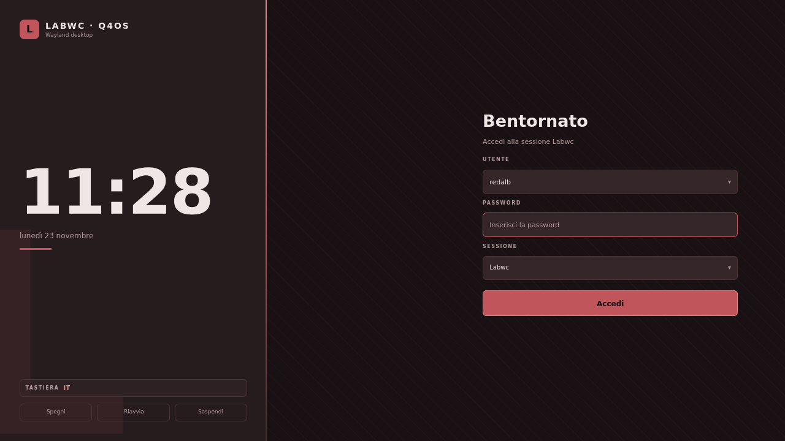
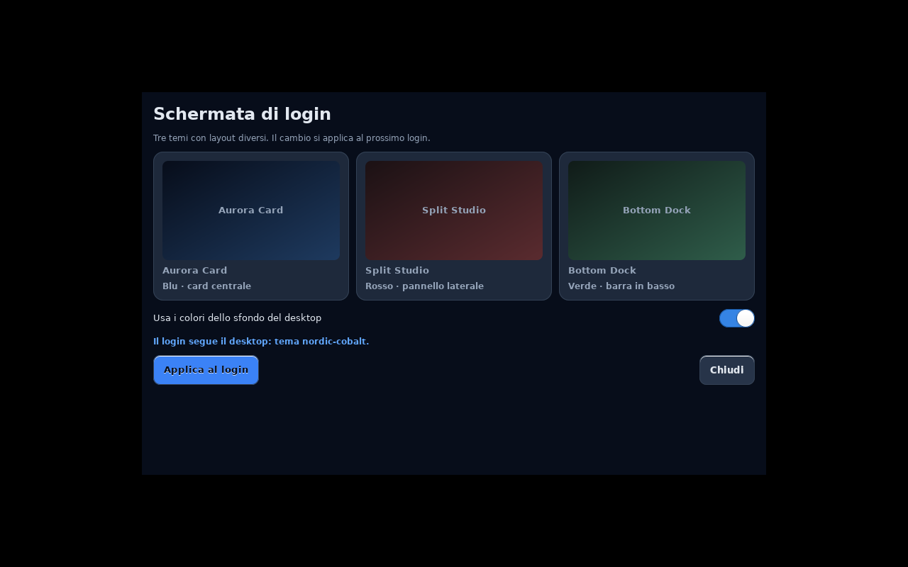
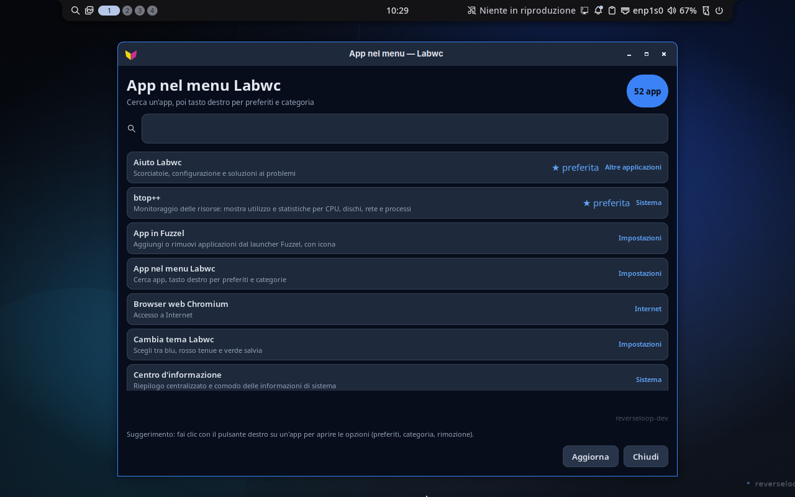
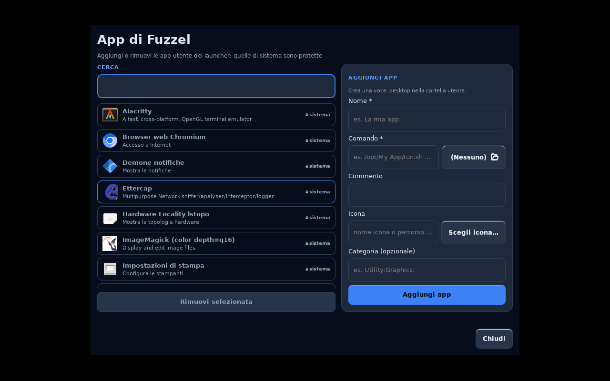

# labwc-q4os

**Una seconda vita per i PC che il mercato considera vecchi.**

Ogni anno milioni di computer ancora perfettamente funzionanti vengono
dismessi solo perché il sistema operativo di serie è diventato lento, pesante
o non più aggiornato. **labwc-q4os** nasce per loro: trasforma un PC di qualche
anno fa in una postazione veloce, moderna e sicura, senza cambiare hardware.

L'idea è il **riuso consapevole**. Non serve un computer nuovo per navigare,
scrivere, lavorare o studiare: serve un sistema costruito bene. Per questo il
progetto parte dalla solidità di **Debian**, aggiunge la configurazione pronta
e collaudata di **Q4OS** e usa **labwc su Wayland** come desktop: un compositor
essenziale che consuma poche risorse, riduce il carico di CPU e RAM e rende
l'interazione più immediata, anche su macchine con pochi gigabyte di memoria.

Il risultato è un desktop curato e completo, con tre temi coordinati, un login
moderno e tutti gli strumenti di uso quotidiano già configurati. Le sessioni
Trinity e Plasma restano disponibili: labwc-q4os **aggiunge** una sessione,
non impone una sostituzione.

> ### Riuso, stabilità, prestazioni
>
> **Meno rifiuti elettronici, più computer utili.** labwc-q4os non richiede
> hardware recente e non introduce un sistema operativo sperimentale: si
> appoggia a Debian, una delle basi più solide e longeve del mondo Linux, e
> alle ottimizzazioni di Q4OS. Sopra questa fondazione, **labwc** offre un
> ambiente Wayland leggero e reattivo, con avvio rapido, basso consumo e
> un'interfaccia grafica moderna. Il PC che hai già può tornare a essere veloce.

> **[Scarica Q4OS 6](https://www.q4os.org/downloads1.html)**

[](https://q4os.org)
[](https://debian.org)
[](https://labwc.github.io)
[](LICENSE)

> **reverseloop-dev** · https://github.com/reverseloop-dev/labwc-q4os · **v1.4.1**

---

## Trinity o Labwc: scegli tu

**Q4OS resta il sistema di base.** labwc-q4os non sostituisce Trinity o
Plasma: aggiunge una sessione **labwc** selezionabile al login. Puoi tenere
tutto e scegliere ogni volta l'ambiente che preferisci.

- **Trinity** è la sessione classica di Q4OS: barra, menu Start e disposizione
  simile a Windows. È la scelta giusta se arrivi da Windows, se ti trovi meglio
  con un'interfaccia tradizionale o se vuoi restare fedele al desktop Q4OS.
  L'installer può aggiungere **LookSwitcher** (solo per Trinity) per cambiarne
  i temi in un clic.
- **Labwc** è la sessione Wayland di questo progetto: compositor minimale,
  **massima reattività**, poche distrazioni e consumo ridotto di CPU, RAM e
  GPU. È pensata per chi vuole un desktop moderno ed essenziale, soprattutto su
  PC vecchi o poco potenti.
- **Plasma** resta disponibile per chi preferisce l'ambiente KDE completo.

In breve: **Trinity per la familiarità di Windows, Labwc per la reattività e
un ambiente sobrio.**

## Cosa aggiunge labwc-q4os

- Compositor **labwc** con decorazioni arrotondate, ombre e snap; finestre con
  i tre pulsanti classici.
- **Waybar + Fuzzel** (default) oppure **Noctalia v5**: barra, launcher,
  notifiche, orologio, tray e menu sessione, con la leggerezza di componenti
  separati o l'integrazione di una shell unica.
- **Mako** per le notifiche, **swaybg** per lo sfondo, **swaylock** per il
  blocco e **labwc-power-menu** per la sessione.
- Tre temi completi e intercambiabili a caldo, con tre sfondi 2560×1440 e icone
  SVG originali coordinate alla palette.
- **Grafica coerente**: tutte le app del progetto (Preferenze, ZRAM, Login,
  Aggiornamenti, App in Fuzzel, App nel menu) seguono il tema attivo.
- **Tre schermate di login SDDM** con layout diversi (Aurora Card, Split
  Studio, Bottom Dock), tastiera IT e sessione Labwc preselezionata. Il login
  può seguire automaticamente i colori dello sfondo.
- **App nel menu Labwc** e **App in Fuzzel**: aggiungi, organizza o rimuovi le
  applicazioni con selezione icona; le voci di sistema restano protette.
- **Chromium** con **uBlock Origin Lite** e **Privacy Badger**; supporto
  **touchscreen** con tastiera su schermo e gesti.
- **ZRAM**, **Labwc Doctor**, **Preferenze**, desktop 1–4 e guida integrata in
  italiano.
- **Aggiornamenti in-app**: controllo versione, password root nella GUI, barra
  di avanzamento e log; popup di avviso con chiusura automatica dopo 15 s.
- zram e swappiness configurabili durante l'installazione.

**In sintesi, l'installer chiede:** se il PC ha un touchscreen, quale shell
usare (Waybar + Fuzzel o Noctalia v5), se installare LookSwitcher per Trinity
(solo se Trinity è presente) e, quando serve, se passare a SDDM. Ogni domanda
ha un flag corrispondente (`--touch`, `--shell`, `--lookswitcher`, `--sddm`).

---

## Anteprime

| Nordic Cobalt (blu) | Muted Crimson (rosso tenue) | Sage Emerald (verde salvia) |
|---|---|---|
|  |  |  |

Ogni sfondo riporta la firma discreta `reverseloop-dev` in basso a destra.

---

## Correzioni recenti

- **LookSwitcher per Trinity** (opzionale, solo sessione Trinity): selettore
  temi Q4OS; labwc resta sui suoi tre temi.
- **Login Plasma/Breeze gestito**: drop-in `99-labwc-q4os.conf` e wrapper di
  sessione che garantiscono tema, sessione e configurazione labwc.
- Scelta della shell: **Waybar + Fuzzel** (default, leggerissima) o
  **Noctalia v5** (shell integrata, repo APT ufficiale di terze parti), con
  fallback automatico e `--shell waybar|noctalia`.
- Tre schermate di login SDDM con layout e stile distinti: **Aurora Card**
  (blu), **Split Studio** (rosso), **Bottom Dock** (verde).
- Nuova app **Schermata di login** e switch **Login uguale allo sfondo** nelle
  Preferenze: il login segue colori e layout del tema desktop.
- Nuova app **App in Fuzzel**: aggiunge e rimuove le voci utente del launcher
  con selezione icona; le app di sistema restano protette.
- Tutte le app del progetto seguono il tema attivo con il colore di riferimento.
- Tastiera **IT** predefinita al login (SDDM/X11 e sessione labwc).
- Chromium installato se assente, con **uBlock Origin Lite** e **Privacy Badger**
  forzate via policy `/etc/chromium/policies/managed/labwc-q4os-extensions.json`.
- Rilevamento touchscreen, con tastiera su schermo **wvkbd** e gesti **lisgd**
  (swipe dal basso), scaling Qt 1.25, font e pulsanti più grandi.
- Popup nuova versione: si chiude dopo **15 secondi**, con **Chiudi**,
  **Copia stringa shell** e **Apri app per aggiornare**.
- Aggiornamento in-app: password root in finestra (`pkexec`), barra di
  avanzamento e log nel riquadro nero; helper root-owned `update-apply`.
- Pulsante sessione di Waybar: ora apre `labwc-power-menu` e le azioni
  riavvio/spegnimento/sospensione/blocco funzionano davvero.
- Editor menu: aggiunta/rimozione più robuste, supporto `remove-id`,
  rimozione diretta dalla sezione **★ App preferite** e protezione dai loop
  su selezioni non valide.
- Nuovo **App nel menu Labwc** con menu contestuale tasto destro per
  preferiti e categorie.
- Doppio clic sinistro sul desktop: guida + informazioni di sistema.
- Pannello ZRAM: corrette unità RAM, label di stato e grafico storico, aggiunta
  dipendenza Cairo.
- Tema labwc: usato `themerc-override` (la vecchia posizione non veniva letta).
- Waybar: rimossi moduli workspace non disponibili nel pacchetto Debian;
  corretti colori `rgba` non validi.
- Aggiunto SDDM opzionale per TDM, con ritorno a TDM documentato.
- Pannello aggiornamenti separato da ZRAM, intervallo configurabile e
  attivazione protetta dalla password di root.
- Popup di aggiornamento persistente: **Aggiorna** apre Terminator col comando
  pronto, **Chiudi** non installa nulla.
- Terminale predefinito passato a **Terminator**.
- Aggiunte Preferenze della scrivania, desktop 1–4 e i tre pulsanti finestra.
- Il menu esclude le voci TDE/Trinity estranee a labwc.

---

## Login moderno SDDM

Se il sistema usa **TDM**, l'installer propone di passare a **SDDM** (default
sì; `--keep-tdm` per restare su TDM). Con SDDM vengono installate **tre
schermate di login complete**, ognuna con layout e stile diversi:

| Tema | Colore | Layout |
|---|---|---|
| **Aurora Card** | blu | card di vetro centrale, aurora animata, griglia di punti |
| **Split Studio** | rosso tenue | pannello laterale con orologio grande, form a destra, spigoli netti |
| **Bottom Dock** | verde salvia | barra orizzontale in basso, alone radiale, form compatto |

Tutte hanno selettore **utente** e **sessione** (Trinity/TDE e Labwc), campo
password, orologio e data in italiano, pulsanti Spegni/Riavvia/Sospendi e
l'indicazione **Tastiera: IT**. La sessione **Labwc è preselezionata**.

| Aurora Card (blu) | Split Studio (rosso) | Bottom Dock (verde) |
|---|---|---|
|  |  |  |

**Sincronizzazione con lo sfondo.** Nelle Preferenze c'è lo switch *Login con
gli stessi colori dello sfondo*: quando è attivo, cambiare tema desktop
(blu/rosso/verde) aggiorna automaticamente anche il login. Lo switch si trova
nello stesso pannello del cambio sfondo. Per scegliere una schermata diversa
dal tema, usa l'app **Schermata di login** (menu del tasto destro):

```bash
labwc-login-theme              # grafica: tre anteprime + switch
labwc-login-theme --show       # stato in JSON
labwc-login-theme --apply muted-crimson
```

L'applicazione al login richiede la password di root una sola volta
(`pkexec`); il cambio diventa effettivo al login successivo.



La tastiera del login è **IT** per impostazione predefinita: l'installer usa
`localectl`, `/etc/default/keyboard` e un fallback in
`/etc/X11/xorg.conf.d/00-keyboard.conf` per SDDM (X11); labwc usa
`XKB_DEFAULT_LAYOUT=it`. Per cambiare layout al login:

```bash
sudo localectl set-keyboard-layout it
# oppure it,us
```

### Se il login era Plasma o Breeze

Se SDDM era configurato dal desktop **Plasma** (tema Breeze o greeter Wayland),
l'installer lo rileva e scrive `/etc/sddm.conf.d/99-labwc-q4os.conf`: essendo
l'ultimo drop-in, prevale sui file di Plasma e forza tema `labwc-q4os`,
`DisplayServer=x11` e sessione `labwc.desktop`.

La sessione Labwc usa anche un piccolo wrapper
`/usr/local/libexec/labwc-q4os/labwc-session`: imposta `HOME` e le variabili
XDG corrette, ripara la configurazione se manca (`labwc-doctor --fix`) e scrive
l'esito in `~/.local/state/labwc-q4os/session.log`. Serve a evitare lo schermo
nero con menu minimo quando il login non è quello installato dal progetto.

Se dopo l'installazione il login mostra ancora Plasma:
```bash
sudo systemctl restart sddm
# controllo dei file:
grep -R "Current=" /etc/sddm.conf /etc/sddm.conf.d 2>/dev/null
cat /usr/share/wayland-sessions/labwc.desktop
```

Se scegli di mantenere TDM, il tema SDDM viene comunque installato ma non
usato: TDM non supporta le sessioni Wayland. In quel caso avvia
`labwc` da TTY o reinstalla con `./install.sh --sddm`.

---

## Requisiti

- **Q4OS 6.x** (base Debian 13) oppure **Debian 13 o successiva**.
  Q4OS 5.x / Debian 12 **non** includono labwc nei repository: in quel caso
  l'installer si ferma con un messaggio chiaro prima di modificare il sistema.
- GPU e driver in grado di eseguire una sessione Wayland (Intel, AMD, NVIDIA
  con driver proprietari aggiornati).
- Utente normale con privilegi `sudo`. **Non eseguire lo script come root.**
- Connessione internet per i pacchetti `apt` (circa 300–500 MB).
- `git` per l'installazione one-liner.

La sessione Q4OS preesistente resta intatta: labwc viene aggiunto come voce
in `/usr/share/wayland-sessions`. Se è attivo **TDM** — che non supporta
Wayland — l'installer propone di installare e attivare **SDDM** (default sì),
mantenendo Trinity/Plasma selezionabili al login. Con `--keep-tdm` il display
manager non viene toccato; in tal caso si può avviare Labwc da TTY con
`dbus-run-session labwc`.

### Chromium ed estensioni

Se **Chromium** non è presente, l'installer lo installa da apt. Scrive poi la
policy `/etc/chromium/policies/managed/labwc-q4os-extensions.json`, che al
primo avvio installa dal Chrome Web Store:

- **uBlock Origin Lite** (`ddkjiahejlhfcafbddmgiahcphecmpfh`);
- **Privacy Badger** (`pkehgijcmpdhfbdbbnkijodmdjhbjlgp`).

Le estensioni risultano installate dall'amministratore: non serve aggiungerle
a mano. Con `--skip-apt` la policy viene scritta solo se Chromium esiste già.

### Touchscreen

Durante l'installazione lo script chiede se il PC ha un touchscreen; il
default è **sì** quando `labwc-touchscreen` trova un device con
`INPUT_PROP_DIRECT`. `--touch` / `--no-touch` saltano la domanda.

Con il touchscreen attivo l'installer:

- installa `wvkbd`, `lisgd`, `libinput-tools`, `wlr-randr`;
- aggiunge l'utente al gruppo `input` (serve un nuovo login per i gesti);
- scrive `~/.config/labwc/touchscreen.enabled`;
- imposta in `environment`: `QT_SCALE_FACTOR=1.25`, `GDK_SCALE=1`,
  `MOZ_USE_XINPUT2=1`;
- porta a 13 il font di `rc.xml` e a 44 px i pulsanti del titolo nel tema;
- all'avvio avvia `wvkbd-mobintl --hidden` e `lisgd`: **swipe dal bordo
  inferiore verso l'alto** mostra/nasconde la tastiera con `SIGRTMIN`.

Se `wvkbd` o `lisgd` non fossero disponibili nei repository, l'installer
avvisa e il resto della sessione resta invariato.

### Barra e launcher: Waybar + Fuzzel oppure Noctalia v5

Dopo la domanda sul touchscreen l'installer chiede come gestire barra,
launcher e notifiche. La scelta si può forzare con `--shell waybar|noctalia`
e si può cambiare in seguito rieseguendo l'installer con lo stesso flag.

| | **Waybar + Fuzzel** (default) | **Noctalia v5** |
|---|---|---|
| **Cosa è** | Componenti separati: Waybar, Fuzzel, Mako, swaybg | Una shell unica: barra, launcher, notifiche, centro di controllo, sfondo, lock |
| **Risorse** | Molto leggera su CPU, RAM e GPU; adatta a PC vecchi e VM | Nativa OpenGL ES, molto curata ma più esigente su RAM e GPU |
| **Grafica** | GTK3, colori del tema labwc-q4os | Pannelli e animazioni proprie, palette generata dallo sfondo |
| **Uso** | Ogni pezzo è indipendente; Fuzzel e Zenity servono anche agli strumenti del progetto | Esperienza integrata e moderna, con impostazioni grafiche unificate |
| **Installazione** | Pacchetti Debian standard | Repository APT di terze parti `pkg.noctalia.dev`, solo Debian/Q4OS amd64/arm64 |
| **Configurazione** | File del progetto (`configs/`) già pronti | `~/.config/noctalia/config.toml`, hot-reload |

In modalità Noctalia l'installer aggiunge il repository ufficiale del progetto
Noctalia, installa il pacchetto `noctalia`, imposta `Super+D` sul launcher
Noctalia e usa `[theme] source = "wallpaper"` così la palette segue lo sfondo
del tema attivo. Waybar, Mako e swaybg non vengono avviati. Se l'installazione
di Noctalia fallisce (rete, architettura, repository non raggiungibile) si
torna automaticamente a **Waybar + Fuzzel** senza interrompere il resto.

> Noctalia è un progetto indipendente: il repository APT è di terze parti.
> Se preferisci ridurre le dipendenze esterne, resta sul default
> Waybar + Fuzzel.

### LookSwitcher per Trinity (solo Trinity)

Se sul sistema è presente **Trinity** (la sessione classica di Q4OS), dopo la
scelta della shell l'installer chiede se installare **LookSwitcher**, il
selettore di temi del desktop Q4OS Trinity
([q4os-trinity/q4os-desktop](https://github.com/q4os-trinity/q4os-desktop)),
con una breve descrizione. **Riguarda solo Trinity e non modifica labwc**, che
continua a usare i suoi tre temi blu/rosso/verde.

- pacchetto cercato: `lookswitcher-trinity`, fallback `lookswitcher`;
- se i repository Q4OS non lo forniscono, nessuna modifica e avviso;
- `--lookswitcher` / `--no-lookswitcher` per non ricevere la domanda;
- la domanda viene saltata se Trinity non è installato o con `--skip-apt`.

---

## Installazione

### One-liner

```bash
curl -fsSL https://raw.githubusercontent.com/reverseloop-dev/labwc-q4os/main/bootstrap.sh | bash
```

Con opzioni:

```bash
curl -fsSL https://raw.githubusercontent.com/reverseloop-dev/labwc-q4os/main/bootstrap.sh \
  | bash -s -- --theme blue --yes
```

### Manuale

```bash
git clone https://github.com/reverseloop-dev/labwc-q4os.git
cd labwc-q4os
./install.sh
```

### Opzioni

| Opzione | Effetto |
|---|---|
| `--theme blue\|red\|green` | Tema iniziale: `nordic-cobalt`, `muted-crimson`, `sage-emerald` |
| `--theme nordic-cobalt` | Nome completo del tema |
| `--yes` | Nessuna domanda: zram e swappiness attivi, tema corrente o blu |
| `--zram` / `--no-zram` | Attiva/disattiva zram senza prompt |
| `--keyboard LAYOUT` | Layout labwc/login: `it`, `us`, `it,us` (default rilevato) |
| `--touch` / `--no-touch` | Installa o esclude tastiera su schermo e gesti touch |
| `--shell waybar\|noctalia` | Barra/launcher: Waybar+Fuzzel (default) o Noctalia v5 |
| `--lookswitcher` / `--no-lookswitcher` | Selettore temi LookSwitcher per Trinity (solo Trinity) |
| `--swappiness N` | Imposta `vm.swappiness` a `N` (0–200) |
| `--no-swappiness` | Non modificare `vm.swappiness` |
| `--sddm` | Installa e attiva SDDM se TDM non supporta Wayland |
| `--keep-tdm` | Non toccare il display manager |
| `--skip-apt` | Salta l'installazione pacchetti (solo configurazione) |
| `--force-os` | Procede anche su distribuzioni non Debian |
| `--help` | Aiuto |

Durante l'esecuzione lo script chiede:

1. **zram** — RAM compressa con `zstd`, 50% della RAM. Migliora la reattività
   su macchine con 4–8 GB.
2. **swappiness** — parametri `vm.swappiness` e `vm.vfs_cache_pressure`
   persistenti in `/etc/sysctl.d/99-labwc-performance.conf`.
3. **touchscreen** — se il PC ha un pannello touch, installa tastiera su
   schermo e gesti (default sì se viene rilevato).
4. **shell desktop** — Waybar + Fuzzel (default, leggero) oppure Noctalia v5
   (shell integrata, più risorse; repository APT di terze parti).
5. **LookSwitcher** — solo se Trinity è installato: selettore di temi per la
   sessione Trinity; non tocca labwc (saltata con `--skip-apt`).
6. **display manager** — solo se è attivo TDM: propone SDDM per rendere
   Labwc selezionabile al login (TDM resta installato).

Scelta tecnica trasparente: con zram lo swap avviene in RAM compressa, quindi
`vm.swappiness=100` è desiderabile e non consuma il disco. Senza zram il
valore scende a `10` per evitare swap su disco prematuri. In entrambi i casi
`vm.vfs_cache_pressure=50` mantiene in cache inode e dentry, riducendo il
lavoro del disco. Con zram viene anche impostato `vm.page-cluster=0`, ottimale
per la compressione in RAM.

zram viene configurato anche se scegli di non attivarlo: potrai accenderlo e
spegnerlo in qualsiasi momento dal pannello grafico **ZRAM — memoria
compressa** nel menu del tasto destro, con indicatori di uso, compressione,
swap e RAM in tempo reale.

Al termine, se SDDM è stato attivato riavvia il sistema e scegli **Labwc**
dal login. Con TDM: **Menu → Session Type → Labwc** (se disponibile).

I comandi `labwc-*` sono installati in `~/.local/bin`, che Debian/Q4OS
aggiunge al `PATH` al login. Se il tuo profilo non lo fa:

```bash
export PATH="$HOME/.local/bin:$PATH"
```

---

## Dopo l'installazione

Al primo login partono automaticamente:

- con **Waybar + Fuzzel** (default): sfondo del tema (`swaybg`), Waybar,
  Mako per le notifiche;
- con **Noctalia v5**: la shell Noctalia, che gestisce barra, launcher,
  notifiche, centro di controllo e sfondo (Waybar/Mako/swaybg non partono);
- in entrambi i casi: `nm-applet`, `lxpolkit` e la cronologia appunti con
  `cliphist` (se installato).

### Tasti rapidi

`Super` è il tasto Windows/Logo.

| Combinazione | Azione |
|---|---|
| `Super + Invio` | Terminale Terminator |
| `Super + D` | Launcher: Noctalia (se scelto) o Fuzzel |
| `Super + Spazio` / `Alt + F2` | Launcher Fuzzel |
| `Super + E` | File manager (pcmanfm) |
| `Super + Q` / `Alt + F4` | Chiudi finestra |
| `Super + A` | Massimizza / ripristina |
| `Super + F` | Schermo intero |
| `Super + Frecce` | Snap a sinistra/destra/alto/basso |
| `Super + Tab` / `Alt + Tab` | Finestra successiva |
| `Super + 1…4` | Vai al desktop |
| `Super + Shift + 1…4` | Sposta finestra sul desktop |
| `Super + Shift + R` | Ricarica menu, tema e Waybar |
| `Super + Shift + T` | Cambia tema |
| `Super + Shift + M` | Editor app del menu |
| `Super + Shift + H` | Guida completa |
| `Stampa` / `Super + Shift + S` | Screenshot area (grim + slurp) |
| `Super + Stampa` | Screenshot schermo intero |
| `Super + L` | Blocca schermo |
| `Super + Ctrl + L` | Menu sessione |
| Tasti volume/luminosità | Audio e brightnessctl |

Tasto destro sul desktop: menu completo. **Doppio clic sinistro sul desktop:**
guida, scorciatoie e informazioni di sistema (versioni, tema, repo, ultimo
aggiornamento). Tasto destro sul titolo: menu della finestra. Rotellina sul
desktop: cambia desktop.

---

## Temi

| Tema | Palette | Carattere |
|---|---|---|
| **Nordic Cobalt** | `#1e293b` · `#3b82f6` | Blu profondo, riposante, tech |
| **Muted Crimson** | `#261c1e` · `#c0565b` | Rosso spento, caldo, sofisticato |
| **Sage Emerald** | `#1b2624` · `#4d9375` | Verde salvia, equilibrato, naturale |

Il cambio tema aggiorna in tempo reale:

- `themerc-override` di labwc (bordi, titoli, menu, OSD, snap overlay);
- `~/.config/waybar/style.css`;
- `~/.config/fuzzel/fuzzel.ini`;
- `~/.config/mako/config`;
- `~/.config/wlogout/style.css`;
- lo sfondo del desktop.

Comandi:

```bash
labwc-theme-switcher                 # selettore Fuzzel/Zenity
labwc-theme-switcher nordic-cobalt   # cambio diretto
labwc-theme-switcher muted-crimson
labwc-theme-switcher sage-emerald
```

Gli sfondi sono generati localmente da `scripts/generate-wallpapers.py` con
Pillow: gradienti mesh, geometrie sottili, grana e vignettatura. Nessun link
esterno, nessuna licenza di terzi.

Rigenerazione:

```bash
labwc-generate-wallpapers
```

Le immagini finiscono in `~/.local/share/labwc-q4os/wallpapers/`.

### Icone coordinate al tema

Ogni tema ha un set di icone SVG **originali**, moderne e stilizzate, disegnate
localmente e colorate con la palette attiva: blu per Nordic Cobalt, rosso
spento per Muted Crimson, verde salvia per Sage Emerald. Non vengono scaricate
da repository esterni, quindi non ci sono dubbi di licenza o link che possano
rompersi.

Il set copre terminale, file manager, browser, impostazioni, audio, rete,
batteria, sessione, screenshot, monitor, tema, ricerca, cartelle, documenti e
categorie. Viene applicato a:

- icone GTK (`gtk-icon-theme-name=labwc-q4os`);
- taskbar di Waybar;
- Fuzzel;
- Mako;
- finestre di ZRAM e App nel menu Labwc.

Al cambio tema il symlink `~/.local/share/icons/labwc-q4os` punta al set del
nuovo tema; Waybar viene riavviata e gli altri componenti usano le nuove icone
alla successiva apertura.


---

## Menu del tasto destro

Il menu e' generato dinamicamente da `scripts/render-menu.py` leggendo i file
`.desktop` installati:

1. **★ App preferite** — scelte dall'utente, in cima al menu.
2. **Categorie** — Internet, Multimedia, Grafica, Ufficio, Sviluppo, Giochi,
   Istruzione, Scienza, Sistema, Impostazioni, Accessori, Altre applicazioni.
3. **Labwc & Desktop** — preferenze della scrivania, desktop 1–4, gestione
   app/preferite, cambio tema, editor rapido Fuzzel, ricarica, aiuto,
   screenshot, pannello ZRAM, controlli aggiornamenti, diagnostica, blocco
   schermo e menu sessione.

### App nel menu, preferite e categorie

Fuzzel **non supporta menu contestuali per singola voce**: il tasto destro su
un'app dentro Fuzzel non può essere intercettato. Per ottenere la stessa
funzione c'è **App nel menu Labwc** (`labwc-app-manager`), apribile da:

- tasto destro sull'icona launcher di Waybar;
- menu desktop → **Labwc & Desktop → Gestisci app e preferite**;
- ricerca Fuzzel: “App nel menu Labwc”.

Qui il **tasto destro su una riga** permette di:

- **Aprire** l'app;
- **Aggiungere ai preferiti**;
- **Spostare in categoria** (Multimedia, Internet, Grafica, Ufficio, ...);
- **Rimuovere dai preferiti**;
- **Ripristinare la categoria automatica**.

Nella sezione **★ App preferite** del menu desktop è presente anche
**“Rimuovi dai preferiti...”**, per eliminare una voce senza aprire l'editor.

### Preferenze della scrivania e desktop

Tasto destro → **Labwc & Desktop → Preferenze della scrivania Labwc** apre un unico
pannello per:

- scegliere il tema e quindi icone, Waybar, Fuzzel, sfondo;
- impostare la tastiera `it`, `us` o `it,us`;
- selezionare i desktop **1–4**;
- aprire ZRAM, aggiornamenti, App nel menu e aiuto.

La Waybar mostra inoltre l'indicatore **`[1] 2 3 4`**: click sull'indicatore per
scegliere il desktop. I desktop restano selezionabili anche con `Super + 1…4` e
con la rotellina sul desktop.

Le finestre usano decorazioni lato server di labwc con i tre pulsanti classici
**riduci a icona, ingrandisci, chiudi**; `GTK_CSD=0` evita che le app GTK
sostituiscano la barra con decorazioni client-side.




### Aggiungere o rimuovere app

Tasto destro → **Labwc & Desktop** → **Gestisci app e preferite**
(oppure `Super + Shift + M` per l'editor rapido Fuzzel).

L'editor usa Fuzzel (`--dmenu`) su Wayland, con fallback a Zenity e Whiptail.
Legge:

- `/usr/share/applications`
- `/usr/local/share/applications`
- `~/.local/share/applications`
- esportazioni Flatpak
- Snap desktop entries

Ad ogni modifica:

1. `~/.config/labwc/favorites.tsv` viene aggiornato;
2. `menu.xml` viene rigenerato;
3. `labwc --reconfigure` applica il menu immediatamente.

`favorites.tsv` sopravvive agli aggiornamenti e alle reinstallazioni.
Il menu e' già aggiornato: non serve riavviare la sessione.

### Ricarica manuale

Voce **Ricarica menu e desktop** oppure `Super + Shift + R`:

- `labwc --reconfigure`;
- riavvio di Waybar;
- `makoctl reload`.

---

## Aiuto integrato

`Super + Shift + H`, doppio clic sinistro sul desktop, oppure tasto destro →
**Aiuto, scorciatoie e sistema**, apre una guida italiana con:

- tutti i tasti rapidi;
- uso di Fuzzel e modalità `--dmenu`;
- percorso e scopo di ogni file di configurazione;
- esempi per modificare `rc.xml`, `style.css`, `fuzzel.ini`, `mako/config`,
  `autostart` e `environment`;
- comandi di ricarica e troubleshooting;
- gestione screenshot e cronologia appunti;
- versione script, data di installazione, versioni delle app, tema, sessione
  e link al repository.

Il file sorgente è `~/.config/labwc/help.txt`.

---

## Tastiera italiana e layout di login

Durante l'installazione viene rilevato il layout del sistema e della lingua.
Con locale italiano il default è **`it`**; è possibile scegliere anche
`us` o `it,us` (Alt+Shift per passare da uno all'altro).

```bash
./install.sh --keyboard it
./install.sh --keyboard it,us
```

Vengono configurati:

- `~/.config/labwc/environment` → `XKB_DEFAULT_LAYOUT=it` (e opzioni di switch);
- `/etc/default/keyboard` e `localectl` → layout del login/console (TDM, SDDM, TTY).

Per modificare solo labwc:

```text
~/.config/labwc/environment
  XKB_DEFAULT_LAYOUT=it
  # XKB_DEFAULT_OPTIONS=grp:alt_shift_toggle   # solo per it,us
```

Poi `Super+Shift+R` o `labwc --reconfigure`. Per il login:

```bash
sudo localectl set-keyboard-layout it
# oppure
sudo dpkg-reconfigure keyboard-configuration
```

---

## ZRAM — memoria compressa

Pannello grafico: tasto destro → **Labwc & Desktop** → **ZRAM — memoria
compressa**, oppure `labwc-zram`.

Mostra in tempo reale:

- stato **attivo / non attivo** e avvio automatico del servizio `zramswap`;
- barra della RAM di sistema e barra dello swap su zram;
- rapporto di compressione e RAM realmente occupata da zram;
- grafico dell'occupazione degli ultimi 3 minuti;
- dispositivo, algoritmo (`zstd`), dimensione, `vm.swappiness`.

Pulsanti **Attiva zram** e **Disattiva zram**: eseguono `systemctl
enable/disable --now zramswap` tramite `pkexec` e l'agente polkit della
sessione. L'attivazione abilita anche zram all'avvio.

Da terminale:

```bash
labwc-zram --status
labwc-zram --enable
labwc-zram --disable
```

Configurazione: `/etc/default/zramswap` (`ALGO=zstd`, `PERCENT=50`,
`PRIORITY=100`). L'installer scrive sempre questa configurazione, anche se
scegli di non attivare subito zram.


> Nota: il pannello è stato verificato in ambiente Debian 13 con Python
> PyGObject/GTK3. Se GTK non è disponibile, `labwc-zram --status` resta
> utilizzabile e l'installer segnala la dipendenza mancante.

---

## Controllo aggiornamenti

All'avvio di labwc, **se il controllo è abilitato**, `labwc-update-check`
attende la connessione internet e confronta:

- la versione installata in `~/.local/share/labwc-q4os/version-info`;
- la versione online `VERSION` del repository GitHub.

Se la versione online è più recente compare un **popup** con
installata/disponibile che **si chiude da solo dopo 15 secondi**. Sotto il
testo ci sono tre pulsanti:

- **Chiudi** → chiude subito il popup senza fare nulla;
- **Copia stringa shell** → copia negli appunti:
  ```bash
  curl -fsSL https://raw.githubusercontent.com/reverseloop-dev/labwc-q4os/main/bootstrap.sh | bash
  ```
- **Apri app per aggiornare** → apre il pannello (`labwc-update-gui`) con la
  finestra di aggiornamento già avviata.

L'aggiornamento in-app chiede la **password di root una sola volta** tramite
`pkexec` (finestra di sistema, nessun terminale), mostra una **barra di
avanzamento** e le **righe di avanzamento in un riquadro nero**. Usa l'helper
root-owned `/usr/local/libexec/labwc-q4os/update-apply`: i sorgenti sono
clonati in una directory temporanea di root e, a fine corsa, i file
dell'utente tornano al proprietario originale.

In alternativa resta il flusso manuale: dalla finestra **Copia comando**, poi
Incolla nel terminale e premi Invio. Il controllo non installa nulla da solo:
l'aggiornamento parte sempre da un'azione esplicita dell'utente. Se GTK non è
disponibile, viene usata una notifica Mako persistente.


Il controllo ha un pannello dedicato:
tasto destro → **Labwc & Desktop → Controlli aggiornamenti script labwc-q4os**
(`labwc-update-gui`), separato da ZRAM.


- check **Controlla aggiornamenti all'avvio** → l'utente normale può
  **disattivare** subito; per **riattivare** serve la password di root
  (`pkexec` + helper installato root-owned);
- intervallo predefinito **6 ore**, modificabile da 1 a 24 ore;
- **Aggiorna ora** → aggiornamento in-app con password root in GUI, barra di
  avanzamento e log nel riquadro nero;
- **Controlla ora** → verifica immediata;
- **Copia comando** → copia il bootstrap negli appunti;
- **Apri repository**;
- stato ultimo controllo / nuova versione visibile nel pannello.

Da terminale:

```bash
labwc-update-check --status
labwc-update-check --once
labwc-update-check --enable    # chiede la password di root
labwc-update-check --disable   # disattivazione utente, senza password
labwc-update-check --set-interval 21600
```

Lo stato è salvato in:

```text
/etc/labwc-q4os/update-check.enabled        # flag root
~/.config/labwc/update-check.disabled       # disattivazione utente
~/.config/labwc/update-check.interval       # intervallo in secondi
~/.local/state/labwc-q4os/update-status.json
```

---

## Labwc Doctor

Controlli automatici e riparazione:

```bash
labwc-doctor
labwc-doctor --fix
labwc-doctor --fix-system
```

Verifica:

- labwc e versione minima;
- comandi essenziali e opzionali;
- `/dev/dri`, sessione Wayland e processi Waybar/Mako/swaybg;
- `XDG_RUNTIME_DIR` e permessi;
- XML di `rc.xml` e `menu.xml`, JSON di Waybar, token CSS non risolti;
- tema, sfondo, menu, preferite, Waybar, Fuzzel, Mako, wlogout;
- sessione `/usr/share/wayland-sessions/labwc.desktop`;
- display manager e supporto Wayland;
- XWayland e portali;
- zram, `vm.swappiness`, `vm.vfs_cache_pressure`;
- errori recenti in `~/.local/state/labwc-q4os/session.log`.

`--fix` ripristina i file utente mancanti dai template, rigenera tema e menu,
ricrea lo sfondo e ricarica il desktop. `--fix-system` ripristina anche la
sessione Wayland con `sudo`. Dal menu: **Labwc & Desktop → Diagnostica e
ripara desktop**.

---

## Waybar

Moduli attivi:

| Modulo | Interazione |
|---|---|
| Launcher icona menu | Click: Fuzzel · tasto destro: App nel menu Labwc |
| Taskbar | Click: attiva · centrale: chiude · destro: fullscreen |
| Orologio | Click: calendario · tooltip: mese |
| Tray | Applicazioni di sistema |
| Audio | Click: `pavucontrol` |
| Rete | Click: `nm-connection-editor` |
| Batteria | Dettagli con `upower` (se presente) |
| CPU / RAM | Utilizzo in tempo reale |
| icona sessione | Click: menu sessione · destro: swaylock |

Il modulo workspace sperimentale (`wlr/workspaces`) non è incluso nel pacchetto
Waybar di Debian. La barra usa quindi la **taskbar** con le finestre aperte; per
cambiare desktop usa `Super + 1…4` (o la rotellina sul desktop).

File:

```text
~/.config/waybar/config.jsonc
~/.config/waybar/style.css
```

Dopo una modifica: `Super + Shift + R`.

---

## Fuzzel

File: `~/.config/fuzzel/fuzzel.ini`.

- icone abilitate;
- font Inter con fallback;
- bordo arrotondato, overlay centrato;
- colori del tema attivo.

Uso da terminale:

```bash
fuzzel
printf 'Voce 1\nVoce 2\n' | fuzzel --dmenu
scelta="$(printf 'Si\nNo\n' | fuzzel --dmenu --prompt='Confermi? ')"
```

### Aggiungere o togliere un link in Fuzzel

Fuzzel mostra i link come normali applicazioni `.desktop`. L'app **App in
Fuzzel** (`labwc-fuzzel-apps`, tasto destro → *Labwc & Desktop → App in Fuzzel*)
fa tutto dalla grafica: nome, comando con selettore file, commento e **scelta
dell'icona** dal set installato o da un PNG/SVG.



La rimozione è limitata alle voci create dall'utente in
`~/.local/share/applications`: le applicazioni di sistema in
`/usr/share/applications` non vengono mai toccate. Se una voce utente copre
un'app di sistema, l'app avvisa che rimuovendola ricompare quella di sistema.

Da terminale:

```bash
labwc-fuzzel-apps --list
labwc-fuzzel-apps --add "Mio link" --exec "xdg-open https://example.com" \
    --icon web-browser --comment "Sito preferito"
labwc-fuzzel-apps --remove mio-link.desktop
```

Aggiunta manuale, se preferisci:

```ini
# ~/.local/share/applications/mio-link.desktop
[Desktop Entry]
Type=Application
Name=Mio link
Comment=Sito web preferito
Exec=xdg-open https://example.com
Icon=web-browser
Terminal=false
Categories=Network;
```

```bash
update-desktop-database ~/.local/share/applications
```

Il link appare in Fuzzel e nella categoria **Internet** del menu desktop.

---

## Struttura del repository

```text
labwc-q4os/
├── install.sh                     # entry point
├── bootstrap.sh                   # one-liner: clone + install
├── VERSION                        # versione script
├── configs/
│   ├── labwc/rc.xml               # keybind, mouse, desktop
│   ├── labwc/autostart            # avvio sessione
│   ├── labwc/environment          # variabili Wayland
│   ├── waybar/config.jsonc
│   ├── waybar/style.css.in        # template colorato
│   ├── fuzzel/fuzzel.ini.in
│   ├── mako/config.in
│   ├── wlogout/{layout,style.css.in}
│   ├── gtk/settings.ini
│   ├── sddm/themes/{nordic-cobalt,muted-crimson,sage-emerald}/
│   │   └── {Main.qml,theme.conf,metadata.desktop}   # 3 login
│   └── themes/<tema>/{theme.conf,themerc}
├── scripts/
│   ├── generate-wallpapers.py     # sfondi con Pillow
│   ├── generate-icons.py          # icone SVG per i tre temi
│   ├── render-menu.py             # menu.xml dinamico
│   ├── labwc-theme-apply          # applica un tema
│   ├── labwc-theme-switcher       # selettore tema
│   ├── labwc-menu-editor          # aggiungi/rimuovi app
│   ├── labwc-reload               # reconfigure + Waybar
│   ├── labwc-screenshot           # grim + slurp
│   ├── labwc-zram                 # pannello GTK zram
│   ├── labwc-app-manager          # gestore app/preferite/categorie
│   ├── labwc-fuzzel-apps          # aggiungi/rimuovi app in Fuzzel, con icona
│   ├── labwc-update-check         # controllo versione online
│   ├── labwc-update-copy          # copia comando di aggiornamento
│   ├── labwc-update-popup         # popup 15 s: chiudi, copia, apri GUI
│   ├── labwc-update-run           # terminale col comando precompilato
│   ├── labwc-update-gui           # pannello + aggiornamento in-app
│   ├── labwc-update-toggle        # helper root per l'attivazione
│   ├── labwc-update-apply         # helper root: aggiornamento da GUI
│   ├── labwc-login-theme          # 3 schermate login + switch sfondo
│   ├── labwc-login-theme-apply    # helper root: applica tema SDDM
│   ├── labwc-preferences          # preferenze scrivania
│   ├── labwc-desktop              # cambio desktop 1-4
│   ├── labwc-desktop-state        # stato desktop per Waybar
│   ├── labwc-desktop-status       # indicatore [1] 2 3 4
│   ├── labwc-desktop-menu         # selettore desktop 1-4
│   ├── labwc-power-menu           # menu sessione Fuzzel/Zenity
│   ├── labwc-sysinfo              # versioni e informazioni sistema
│   ├── labwc-touchscreen          # rileva /dev/input/eventX del touchscreen
│   ├── labwc-session-launch      # wrapper sessione (login Plasma/SDDM)
│   ├── labwc-doctor               # diagnostica e riparazione
│   ├── labwc-session-start        # autostart sessione
│   ├── labwc-help                 # visualizzatore guida
│   ├── labwc-generate-wallpapers
│   ├── help.txt                   # guida italiana
│   └── validate.sh                # controlli statici e smoke test
├── preview/                       # anteprime sfondi, icone, GUI
├── LICENSE
└── README.md
```

---

## File installati

Configurazione utente:

```text
~/.config/labwc/rc.xml
~/.config/labwc/menu.xml
~/.config/labwc/favorites.tsv
~/.config/labwc/placements.tsv
~/.config/labwc/themerc-override
~/.config/labwc/theme
~/.config/labwc/autostart
~/.config/labwc/environment
~/.config/labwc/help.txt
~/.config/labwc/login.conf
~/.config/labwc/shell
~/.config/labwc/touchscreen.enabled        # solo con touchscreen
~/.config/noctalia/config.toml             # solo con Noctalia v5
~/.config/waybar/config.jsonc
~/.config/waybar/style.css
~/.config/fuzzel/fuzzel.ini
~/.config/mako/config
~/.config/wlogout/layout
~/.config/wlogout/style.css
~/.config/gtk-3.0/settings.ini
~/.config/gtk-4.0/settings.ini
~/.local/share/applications/labwc-theme-switcher.desktop
~/.local/share/applications/labwc-menu-editor.desktop
~/.local/share/applications/labwc-help.desktop
~/.local/share/applications/labwc-zram.desktop
~/.local/share/applications/labwc-doctor.desktop
~/.local/share/applications/labwc-app-manager.desktop
~/.local/share/applications/labwc-fuzzel-apps.desktop
~/.local/share/applications/labwc-login-theme.desktop
~/.local/share/applications/labwc-preferences.desktop
~/.local/share/applications/labwc-sysinfo.desktop
```

Dati e strumenti:

```text
~/.local/share/labwc-q4os/{themes,templates,wallpapers,scripts}
~/.local/bin/labwc-*
~/.local/state/labwc-q4os/session.log
~/.local/state/labwc-q4os/update-status.json
~/.config/labwc/update-check.enabled
~/.local/share/labwc-q4os/backups/<data>/
```

Sistema (con `sudo`):

```text
/usr/share/wayland-sessions/labwc.desktop
/etc/default/zramswap                         # sempre, zram attivabile dal menu
/etc/sysctl.d/99-labwc-performance.conf       # solo se swappiness attivo
```

---

## Verifica e sviluppo

Controlli statici e smoke test in una HOME temporanea (non toccano la tua
configurazione):

```bash
./scripts/validate.sh
```

Lo script verifica:

- `bash -n` su tutti gli script;
- compilazione Python (incluso `labwc-zram --status`);
- JSON di Waybar e wlogout;
- XML di labwc;
- permessi `+x`;
- rendering dei tre temi senza token `@@...@@` residui;
- generazione e validazione di `menu.xml`;
- `shellcheck` se installato.

---

## Troubleshooting

**Prima di tutto: esegui la diagnostica**

```bash
labwc-doctor
labwc-doctor --fix
labwc-doctor --fix-system
```

Il doctor controlla configurazioni, permessi, sessione, barra, tema, menu,
zram, portali, XWayland e log, e ripara i file utente mancanti. Dal menu:
**Labwc & Desktop → Diagnostica e ripara desktop**.

**Il pulsante sessione di Waybar non faceva nulla**
Corretto: ora apre `labwc-power-menu` (Fuzzel/Zenity) con blocco, uscita,
sospensione, riavvio e spegnimento. Se un'azione di sistema viene negata,
controlla che `lxpolkit` sia attivo e che il servizio `polkit` sia in esecuzione.

**Non riesco ad aggiungere/rimuovere un'app dal menu**
Usa **App nel menu Labwc** col tasto destro sulla riga, oppure
**Labwc & Desktop → Gestisci app e preferite**. Fuzzel non ha un menu
contestuale per voce. Le preferite si rimuovono anche da **★ App preferite →
Rimuovi dai preferiti...**.

**La sessione Labwc non compare nel display manager**
Verifica che esista `/usr/share/wayland-sessions/labwc.desktop`. Il display
manager deve supportare Wayland: su alcune installazioni Q4OS con **TDM**
le sessioni Wayland non vengono elencate. In quel caso si può avviare da TTY:

```bash
dbus-run-session labwc
```

oppure usare SDDM come display manager. Lo script non cambia il display
manager per non alterare la configurazione Q4OS esistente.

**Waybar non parte**
```bash
cat ~/.local/state/labwc-q4os/session.log
waybar -c ~/.config/waybar/config.jsonc -s ~/.config/waybar/style.css
jq . ~/.config/waybar/config.jsonc
```

**Il menu non si aggiorna**
```bash
labwc --reconfigure
# oppure
labwc-reload
```

**Un'app non compare nel menu**
Controlla che il file `.desktop` abbia un `Exec` valido e che il programma sia
installato:

```bash
grep -E '^(Name|Exec|NoDisplay|Hidden)=' /usr/share/applications/nome.desktop
```

**Il tema non cambia dopo il login**
`~/.config/labwc/theme` deve contenere esattamente uno tra:
`nordic-cobalt`, `muted-crimson`, `sage-emerald`.

**Tornare a TDM dopo aver installato SDDM**
```bash
sudo systemctl disable sddm.service
sudo systemctl enable tdm.service
sudo ln -sf /usr/lib/systemd/system/tdm.service /etc/systemd/system/display-manager.service
printf '/usr/sbin/tdm\n' | sudo tee /etc/X11/default-display-manager
```
Il percorso di TDM può essere `/usr/sbin/tdm` o `/opt/trinity/bin/tdm`; verifica
con `command -v tdm` prima di sovrascrivere il file.

**Ripristinare le configurazioni precedenti**
I backup sono in:

```text
~/.local/share/labwc-q4os/backups/<data>/
```

Copiali indietro nelle rispettive directory `~/.config/`.

**Disinstallare la sessione**
```bash
rm -rf ~/.config/labwc ~/.config/waybar ~/.config/fuzzel ~/.config/mako ~/.config/wlogout
rm -f ~/.local/bin/labwc-*                 # helper del progetto
rm -f ~/.local/share/applications/labwc-*.desktop
rm -rf ~/.local/share/labwc-q4os ~/.local/state/labwc-q4os
sudo rm -f /usr/share/wayland-sessions/labwc.desktop
```
Le impostazioni di Noctalia (`~/.config/noctalia`) e i pacchetti di sistema
restano: rimuovili separatamente solo se non ti servono.
Rimuovi zram/sysctl solo se non ti servono:
```bash
sudo rm -f /etc/sysctl.d/99-labwc-performance.conf
sudo systemctl disable --now zramswap.service
```

---

## Sicurezza e comportamento

- Lo script **non** viene eseguito come root; usa `sudo` solo per `apt`,
  `/usr/share/wayland-sessions` e i file in `/etc`.
- Non modifica il display manager, la sessione predefinita, GRUB o i driver.
- Le configurazioni esistenti vengono salvate prima di essere sostituite.
- `apt-get` usa `--no-install-recommends` e opzioni non interattive.
- Nessun dato viene inviato all'esterno: sfondi e menu sono generati in locale.
- Le app nel menu vengono filtrate in base a `NoDisplay`, `Hidden`, `TryExec`
  ed esistenza dell'eseguibile.

---

## Licenza

MIT — vedi [LICENSE](LICENSE).

Progetto e design: **reverseloop-dev**.
Segnalazioni e pull request: https://github.com/reverseloop-dev/labwc-q4os
